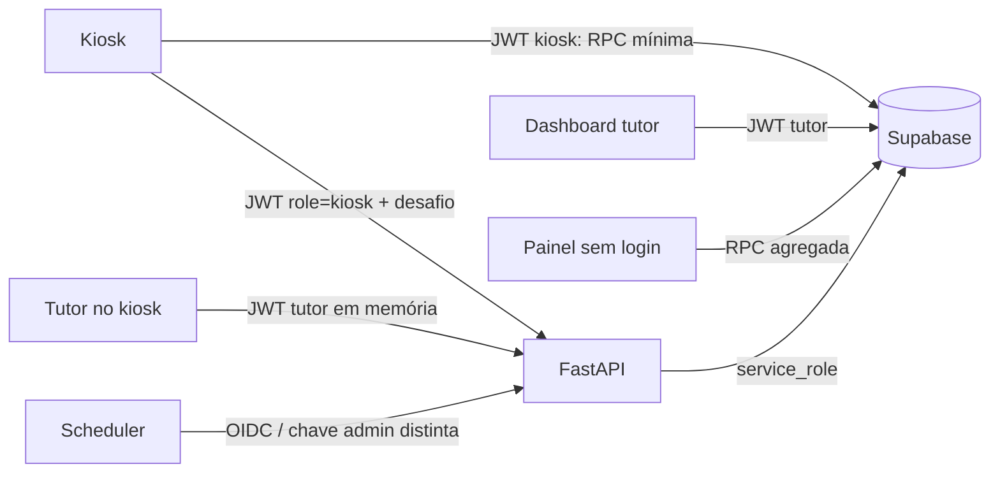
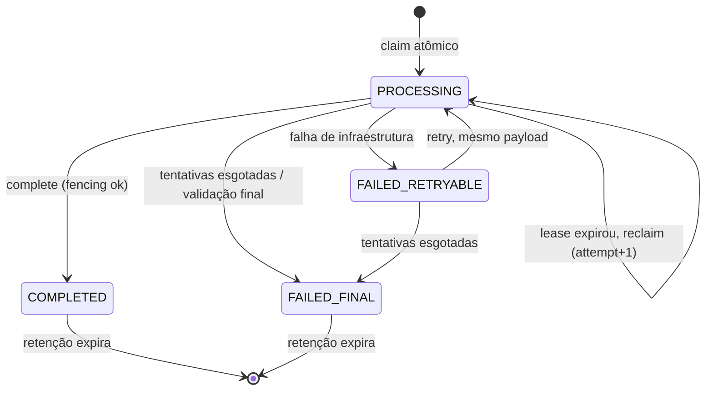

# AILAB-FACIAL — Plano Mestre de Implementação (revisão 4 — Execução Integral Concluída)

> Documento executivo consolidado da implementação integral autônoma do AILAB-FACIAL.
> Abrange migrações 22-28, backend seguro (JWT + anti-replay + ASGI guard + LGPD atômico), Mobile Kiosk v1 (UI + RPCs mínimas + Bearer auth de dispositivo + honestidade offline) e Web Dashboard (UI/UX v1 + funcionalidade Justificar + painel público anônimo DP-1 + acessibilidade WCAG).
> Todas as etapas locais foram implementadas, testadas e verificadas com sucesso. Ações que requerem intervenção humana em ambiente remoto de produção estão documentadas no §16 e no `IMPLEMENTATION_REPORT.md`.

## 1. Estado real do repositório (reconciliado)

Verificação somente leitura feita nesta revisão.

| Evidência | Resultado | Classe |
|---|---|---|
| Branch / HEAD | `master` / `8ae641e8b14c` | FACT |
| `origin/master` (`git ls-remote`) | `8ae641e8b14c` — 0 à frente, 0 atrás | FACT |
| Commits posteriores ao snapshot | nenhum (só branches `dependabot/*` não mescladas) | FACT |
| Outras branches locais, stashes, worktrees | nenhum | FACT |
| Working tree | sem arquivos modificados; **1 não rastreado: `project.zip`** (2,9 MB, 09/11 23:34), **não ignorado** pelo `.gitignore` | FACT |
| Commit da refatoração UI/UX | **não existe** | FACT |
| Onde está a UI/UX v1 | dentro de `project.zip` (cópia do projeto exportada do Figma Make) | FACT |
| Arquivos efetivamente modificados (zip × HEAD, ignorando fim de linha) | `web/src`: **30 modificados + 1 novo** (`components/MemberAvatar.tsx`); `web/index.html` (2 linhas); adicionados `.figma/` e `plans/ui-ux-overhaul-ailab-makers.md`. Backend, mobile, migrações, `tailwind.config.js`, `package.json`, testes: **idênticos**. O relato falava em 28 arquivos — a contagem real é 31 em `web/src` | FACT |
| `tsc --noEmit` | reportado como aprovado no workspace do Figma Make; **não reproduzido** nesta árvore | NV |
| Testes frontend | reportado 43/43. Os 5 arquivos de teste são idênticos aos do repo e somam 43 casos (9+6+11+12+5) — coerente. Cobrem só `web/src/lib`; **nenhum teste exercita UI** | reportado; contagem FACT |
| Build frontend | reportado como aprovado; **não reproduzido** | NV |
| Data da validação | não informada; arquivos do zip com data até 09/11/2026 23:33 | NV |
| `IMPLEMENTATION_PLAN.md` | não existe no repo | FACT |
| Banco consultado | projeto Supabase `ailab-facial`, Postgres 17.6, só catálogo e contagens agregadas | FACT |
| Baseline deste plano | **NOT RUN** (proibido nesta etapa) | — |

**Conclusão:** os dois relatos descrevem árvores diferentes. Os resultados de teste pertencem ao workspace do Figma Make, não ao commit `8ae641e`. A UI/UX v1 é tratada aqui como **“implementada em workspace externo, ainda não integrada ao repositório”**. Tudo que este documento afirma sobre a v1 foi lido do conteúdo do zip (extraído para pasta temporária fora do projeto).

Dois alertas: (1) `project.zip` contém cópia de `eas.json`, do workflow e das migrações com os segredos já conhecidos — **não deve ser commitado**; (2) o zip está em LF e o working tree em CRLF — a integração deve respeitar a normalização do git para não gerar diffs de arquivo inteiro.

## 2. Escopo e objetivos

Plano mestre em fases. **Obrigatório** = segurança (Fase 1), integridade (Fase 2) e solicitação da cliente (Fase 3). Fases 4–6 são qualidade/otimização. UI/UX v2 e itens “Wow” são backlog.

**Escopo visual (corrigido):** a UI/UX v1 passa a ser a **baseline visual**. Preserva-se a identidade, as superfícies, a paleta e os componentes da v1; a refatoração estrutural v1 **não é refeita**; evoluções futuras entram como UI/UX v2, incrementais, rastreadas a referências reais do Figma (§5). O que este plano faz na interface é só: correções **funcionais, de acessibilidade e de veracidade** sobre a v1 e a funcionalidade Justificar.

Fora de escopo: reescrita de módulos; novos serviços de infraestrutura; mudança de thresholds biométricos; redesenho da v1; qualquer especificação visual não fornecida; declaração de conformidade LGPD/ISO.

## 3. Decisões confirmadas e pendentes

**Confirmadas:** justificativa por semana civil seg–dom em America/Sao_Paulo; UI/UX v1 é baseline; Justificar é P2 sem urgência; banco real consultável só em leitura.

**Pendentes (DP):**

| ID | Decisão | Recomendação (não presumida) | Bloqueia |
|---|---|---|---|
| DP-0 | Como integrar a UI v1 ao repo (branch/commit a partir do zip) e o que fazer com `project.zip` e `.figma/` | Branch dedicada; zip fora do versionamento; `.figma/` versionado só se o fluxo Figma Make continuar | Todo trabalho em `web/` |
| DP-1 | Painel sem login: (a) só agregados sem nomes; (b) autenticado, dados do próprio estudante; (c) nominal público com autorização institucional | **Decidida: (a)** | F1.6 |
| DP-2 | Identidade do kiosk | Conta Supabase Auth por dispositivo (§7.3) | F1.5 |
| DP-3 | Quem são os 7 usuários do Auth; destino da conta-semente | Inventário humano; conta-semente desativada | F1.2 |
| DP-4 | Canal único de migração e ambiente efêmero | Stack local do Supabase; aplicação remota registrada | F2.1 |
| DP-5 | Regras de frequência R1–R10 (§11.2) | Preservar comportamento atual onde existir | F3 |
| DP-6 | Exclusão de perfil: justificativas apagadas, anonimizadas ou retidas? Conta de tutor pode ser excluída ou só desativada? | `RESTRICT` + decisão explícita; tutor só desativado | F3 |
| DP-7 | Destino dos 2 templates em perfis com consentimento revogado | Expurgo após confirmação | F2.4 |
| DP-8 | Classes Tailwind sem efeito | **Resolvida pela v1** (definidas em `index.css`) — vale após DP-0 | — |
| DP-9 | Versão canônica de Python/lock | Alinhar CI à imagem | F4.5 |
| DP-10 | Motivo da justificativa e da revogação: obrigatório? formato? limites? | Ver §11.5 | F3 |
| DP-11 | Transição da chave comprometida: corte imediato ou transição controlada (§7.2) | **Decidida: corte imediato** em janela sem uso | F1.4 |
| DP-12 | Semântica do filtro `Meta ≥ 4h` da tabela (período global × semana auditada) | Só chamar de “meta” quando o período for uma semana civil | F3 |
| DP-13 | Capacidade real do laboratório e limites de lotação | Limites como fração da capacidade informada | F3.1 |
| DP-14 | Nova dependência nativa `expo-secure-store` para a sessão do kiosk | Aprovar como pré-requisito de F1.5 | F1.5 |
| DP-15 | Sufixo automático `@ailab.com` no login | Manter só se a política de contas confirmar domínio único | F1.2 |

## 4. Metodologia e evidências

Leitura direta de código (linhas citadas; “zip:” indica arquivo da UI v1), `git` somente leitura, `diff` zip×HEAD, catálogo do Supabase e contagens agregadas. Corpos de `verify_tutor_login`/`sync_tutor_credentials` não foram lidos (contêm credencial). Nenhum dado pessoal extraído.

Classes: **FACT** · **HYP** · **CONF-IMPACT** (reproduzido) · **POT-IMPACT** (provável, não reproduzido) · **NV** (não verificado) · **FIXED** · **FIXED-v1** (corrigido na UI v1, pendente de integração) · **REGRESSION**. Nenhum teste foi executado; não há CONF-IMPACT neste documento.

## 5. UI/UX — Baseline implementada e evolução futura

### 5.1 UI/UX v1 — Implementada (no zip; pendente de integração — DP-0)

| Entrega | Evidência (zip) | Estado |
|---|---|---|
| Quatro níveis de superfície, tema claro e escuro | `web/src/index.css`: `--bg-canvas`, `--bg-surface-1/2/3`, textos, bordas, `--focus-ring`, `--shadow-card`; bloco `html.dark` | Implementado |
| Classes de componente | `index.css`: `surface-card`, `surface-card-interactive`, `surface-muted`, `surface-overlay`, `eyebrow`, `segmented-track/pill`, `btn-primary`, `btn-secondary`, `icon-btn`, `input-field`, `modal-header/footer` | Implementado |
| Utilitários antes inexistentes | `index.css` `@layer utilities`: `text-2xs`, `text-3xs`, `shadow-2xs`, `shadow-xs`, `backdrop-blur-xs`, `z-60`, `z-70`, `scale-98` | Implementado (resíduo: `blur-xs` 2 usos e `animate-slide-up` 1 uso seguem indefinidos) |
| Header global e Footer | `components/Header.tsx` (207 linhas), `Footer.tsx` | Implementado; ver UI-V1 |
| Modal How It Works | `components/HowItWorksModal.tsx` | Implementado; ver UI-V7 |
| Bento Grid, lotação, turnos | `pages/Dashboard.tsx` (1495 linhas), `CROWD_STYLES` `:1262-1295` | Implementado; ver UI-V2 |
| Atalhos globais | `Dashboard.tsx:212-248` | Implementado; ver UI-V5 |
| Chips de filtros ativos | `Dashboard.tsx:1447-1495` | Implementado; ver UI-V3 |
| Tabela: filtros rápidos, pódio, barras | `components/TotalsTable.tsx` (482 linhas) | Implementado; ver UI-V3/V4 |
| `MemberAvatar` com fallback | `components/MemberAvatar.tsx` | Implementado; ver UI-V4 |
| Histórico diário e gráfico semanal | `DailyHistory.tsx`, `WeeklyChart.tsx` | Implementado; ver UI-V6 |
| Login e acesso | `pages/Login.tsx`, `components/SiteAccessGate.tsx` | Implementado; ver UI-V7 |
| Abas com semântica de `tablist` | `Dashboard.tsx:583,630-631` | Implementado |
| `prefers-reduced-motion` | `index.css:446` | Implementado |

O que a v1 **não** tocou (confirmado no zip): `auth/AuthProvider.tsx` (sessão fabricada continua), senhas em `SiteAccessGate.tsx:8`, regra de 4h duplicada, `localStorage` de advertências, relatório sem escape, matriz de acessibilidade dos modais, ticker de 1 s, `signOut()` em erro (`Dashboard.tsx:256,299`), `tailwind.config.js` (paletas antigas ainda declaradas). Nada disso é falha da v1 — estava fora do escopo dela — e continua neste plano como correção funcional/segurança.

Consequências para este plano: saem as tarefas antigas de criar tokens, superfícies, primitivos de botão/cartão/aba e de decidir as classes sem efeito. Entram a integração (DP-0) e a validação abaixo.

### 5.2 Validação pendente da v1 (correções funcionais e de veracidade, não redesign)

| ID | Comportamento | Evidência (zip) | Correção planejada |
|---|---|---|---|
| UI-V1 | Pílula “Sincronizado” verde pulsante **sempre** que há contagem; não há estado de erro, atraso ou desconexão. O dashboard usa polling de 30 s, sem canal realtime | `Header.tsx:60-98`; `Dashboard.tsx:191-192,334-336` | Estado derivado de fatos: *conectando* · *atualizado às HH:MM* · *atualizando* · *dados desatualizados* (idade > 2 ciclos) · *erro de sincronização* · *sem conexão*. Pulso só em atualização ativa. Como é polling, o rótulo honesto é “Atualizado às HH:MM” |
| UI-V2 | Lotação: `≥3` Moderado, `≥8` “Cheio”, sem relação com capacidade; frases fixas apresentadas como recomendação | `web/src/lib/aggregate.ts:444-449` (inalterado); `Dashboard.tsx:1262-1295,923,983` | Limites a partir da capacidade (DP-13); texto descritivo, não prescritivo; pico/tranquilo/turnos com período, fuso SP, tratamento de sessão aberta, amostra mínima, estados vazio e erro |
| UI-V3 | Filtros rápidos combinam com a busca por interseção; contadores calculados sobre as linhas já filtradas pela busca. `Meta ≥ 4h` usa o total do **período** (6ª cópia da regra) | `TotalsTable.tsx:85-105,137-143,170-173` | DP-12; regra única (§11.7); “Restaurar” limpa só filtro rápido e busca — período e semana auditada ficam |
| UI-V4 | Avatar: fallback de imagem e iniciais ok; ponto de presença só tem `title`. Barra é proporcional ao **maior total** (não à meta), largura mínima de 6%, sem texto equivalente | `MemberAvatar.tsx:60-98`; `TotalsTable.tsx:133,342,443` | Texto acessível para presença; definir e rotular o que a barra mede; valor exato por texto; teto visual com valor real preservado |
| UI-V5 | Atalhos `/` e `Ctrl/Cmd+K` ignoram campos editáveis, mas não checam composição de texto nem diálogo/gaveta aberto; `Ctrl/Cmd+K` troca de aba por trás de um diálogo | `Dashboard.tsx:212-248` | Ignorar durante composição e com camada modal aberta; Escape com prioridade: diálogo > busca |
| UI-V6 | Histórico marca anulada e em andamento com texto, não só cor | `DailyHistory.tsx:76-81` | Validar gráficos (pico, linha de referência, nulos, período parcial) |
| UI-V7 | Login acrescenta `@ailab.com`; “Voltar ao Painel Público” leva a `?mode=student`; How It Works descreve templates “irreversíveis” e vivacidade por “reflexos especulares” | `Login.tsx:51,106,258`; `HowItWorksModal.tsx:69,96,136` | DP-15; link condicionado a DP-1; texto alinhado ao pipeline real (B-01, B-07) — sem apresentar heurística como garantia |
| UI-V8 | Botão PWA: some no desktop sem prompt; em mobile não-iOS sem prompt o botão aparece e o clique não faz nada | `InstallPwaButton.tsx:44-58,70-73` | Mostrar só quando houver ação real; cobrir: compatível, incompatível, instalado, sem evento, cancelado, standalone |
| UI-V9 | Modais: 4 de 7 sem contenção de foco; `OfficialReportModal` sem papel de diálogo nem Escape; `TutorProfileModal` sem Escape | contagem por arquivo no zip | Corrigir reaproveitando o padrão já existente em `TutorWarningModal`/`ManualAttendanceModal`, um modal por vez |

Banco, para apoiar UI-V2/V7 (FACT): 48 perfis ativos; os 7 usuários do Auth usam `@ailab.com`.

### 5.3 UI/UX v2 — Evoluções pendentes (Figma)

Nenhuma referência de frame/node foi fornecida além do zip. O zip contém a implementação v1 e o documento `plans/ui-ux-overhaul-ailab-makers.md` (plano da própria v1); `.figma/make/` traz só scripts de build/preview — **não há especificação de telas novas**. Portanto a v2 fica como backlog vazio, sem requisitos inventados. `.figma/make/` não é alterado.

Registro por alteração:

| Campo | Conteúdo |
|---|---|
| Identificador | UI-XXX |
| Tela/componente | — |
| Referência Figma | URL + página + frame/node |
| Tela atual no código | caminho |
| Problema atual / diferença para a referência | — |
| Mudança pretendida | — |
| Componentes, tokens e cores afetados | — |
| Comportamento, responsividade, acessibilidade | — |
| Estados de loading, erro e vazio | — |
| Impacto nos fluxos existentes | — |
| Critério visual de aceite | — |
| Critério funcional de aceite | — |
| Testes de regressão | — |
| Prioridade / dependências | — |
| Status | Pendente de especificação |

Categorias: layout · componentes · tipografia · paleta e superfícies · navegação · microinterações · responsividade · acessibilidade · fluxos de usuário. Cada item v2 é evolução da v1, entra depois de DP-0 e nunca à frente das Fases 1–2.

## 6. Findings atualizados

Formato: evidência → condição → impacto → correção → teste. Risco residual na §17.

### P0
**S-01 — Bearer estático aceito como tutor.** FACT: `backend/app/deps.py:117-118`; usado em `backend/tests/test_enrollment_window.py:153`; emitido por `mobile/components/TutorPinModal.tsx:110,147` e `web/src/auth/AuthProvider.tsx:146-191` (inalterado na v1). Condição: conhecer o literal. POT-IMPACT: cadastro, revogação, exclusão, fechamento de sessão sem identidade. F1.1.

**S-02 — Senha mestra no repo e nos clientes.** FACT: migrações 10/14/19, `AuthProvider.tsx:168`, `TutorPinModal.tsx:24-25`; existe 1 usuário com o e-mail-semente; `verify_tutor_login` só executável por `service_role`. POT-IMPACT: login real como tutor. §7.2, F1.2, F1.3.

**S-03 — Chave do kiosk = chave administrativa, commitada.** FACT: mesmo valor (hash idêntico) em `eas.json`, `mobile/eas.json`, `.github/workflows/nightly-cleanup.yml`; também dentro de `project.zip`. POT-IMPACT: acesso a rotas de manutenção e **registro indevido de presença** — combinado a B-01/B-02, quem tem a chave pode pedir desafio, enviar frames e gerar check-in/check-out. §7.2, F1.4.

**S-04 — `link_tutor_profile` aberta a `anon`.** FACT (banco): `SECURITY DEFINER`, dono `postgres` (BYPASSRLS), ACL com `anon`/`authenticated`, sem checagem de chamador. POT-IMPACT: marcar qualquer perfil como tutor, sequestrar `tutor_email`, oráculo de matrícula (não eleva papel no JWT). F1.3.

**S-05 — Sessão web fabricada e papel por `user_metadata`.** FACT: `AuthProvider.tsx:17-23,78-80,114-116,228-231`; `SiteAccessGate.tsx` com senhas no código; `App.tsx:15-21`. F1.2.

### P1
**S-06 — Credencial de kiosk compartilhada, sem identidade.** FACT. F1.5.

**S-07 — Um único cliente Supabase no mobile para kiosk e tutor.** FACT: `mobile/lib/supabase.ts` exporta um cliente com `persistSession: true` em `AsyncStorage`; `TutorPinModal.tsx:72` faz `signInWithPassword` nele. POT-IMPACT: login de tutor substitui/persiste a sessão; no modelo novo, sobrescreveria a sessão do kiosk. F1.5.

**D-01 — `anon` lê perfis ativos (todas as colunas) e sessões não anuladas.** FACT: policies `anon_select_active_profiles`, `anon_select_sessions`; grants completos; publicação realtime de `profiles` e `sessions`. Consumidores: `mobile/hooks/useProfiles.ts:20`, `usePresence.ts:50,112`, `web/src/lib/reports.ts:28,89,112,143`. F1.6.

**D-05 — Privilégios padrão concedem tudo a `anon`/`authenticated`** em objetos novos de `public` (FACT, `pg_default_acl`). Regra em toda migração.

**D-06 — Helper `require_tutor_or_service` é contornado dentro de `SECURITY DEFINER`** (retorna cedo quando `current_user` é `postgres`; FACT pela fonte). Hoje não explorável (`sync_tutor_credentials` não é executável por `authenticated`). §7.5.

**D-02 — RPCs `tutor_*` (INVOKER) dependem de helper sem `EXECUTE` para `authenticated`.** Mecanismo FACT; efeito POT-IMPACT (fallbacks não atômicos de `reports.ts`). F1.3.

**D-03 / D-08 — Histórico de migrações divergente; job `pg_cron` de sweep só no banco** (24 execuções/24 h, 0 falhas — FACT). §9.

**D-04 — Presença read-check-write no cliente.** FACT: `session_service.py:133-204`; checkout sem `check_out IS NULL` (`:195`); lock só em memória. F2.3.

**D-07 — FKs reais sem cascade** em `sessions` e `face_logs` (FACT). POT-IMPACT: exclusão de perfil pela metade (`profiles.py:124-152`). F2.4.

**B-01 — Verificação por flash não decide nada.** FACT: `liveness_service.py:367`; caminhos de exceção aprovam; `face_service.py:543,561,570`. F4.2.

**B-02 — PAD pode não rodar e ainda aprovar; readiness sempre 200.** FACT: `liveness_service.py:39-46,249-255,284-306`; `health.py:8-21`. F4.1.

**B-03 — Anti-replay e idempotência por processo.** FACT: `challenge_service.py:25,33-37,141-147`; `recognize.py:48-50,128`; desafio consumido antes de validar imagens (`:153` × `:175`). F2.2.

**B-04 — Reconhecimento pós-revogação via cache.** FACT (caminho): `face_service.py:455-480`, TTL 180 s; revogações pelo dashboard (`reports.ts:283`) nunca invalidam cache. POT-IMPACT. F2.4.

**B-05 — Chave do kiosk e nomes em logs.** FACT: `recognize.py:67`; `face_service.py:399-414,578-584`. F1.7.

**B-10 — Upload: ordem de autenticação, limites e taxa (novo).** FACT: (a) `/recognize` lê o corpo manualmente (`recognize.py:139`), então a dependência de chave roda antes; mas a consulta de idempotência (`:128`) e a leitura do multipart (`:139`) vêm **antes** do rate limit (`:148`); (b) `/enroll` (`enroll.py:30-34`) e `/profiles/{id}/refresh-embedding` (`profiles.py:45-47`) declaram `Form`/`File` na assinatura; (c) não existe limite de tamanho de corpo, de partes nem de `Content-Length` em nenhum ponto de `backend/app`; (d) só `/recognize` tem rate limit. HYP (a provar por teste): nas rotas (b) o FastAPI analisa o multipart inteiro antes de executar as dependências de autenticação. POT-IMPACT: consumo de memória/disco/CPU por requisição não autenticada. F2.5.

**L-02 — 2 templates biométricos em perfis com consentimento revogado.** FACT (banco). Não casam hoje (filtro `active`). Causa NV. F2.4, DP-7.

**M-01 — Kiosk sem timeout, abort = offline, fila sem consumidor.** FACT: `mobile/lib/api.ts:41`; `RecognitionPanel.tsx:170-185,318-344`; grep de consumidores. F5.

**C-01 — CI e imagem usam conjuntos de dependência diferentes.** FACT. A imagem roda o lock antigo (`fastapi 0.111.0`, `starlette 0.37.2`, `python-multipart 0.0.9`); HYP: versões com avisos de segurança conhecidos em parsing de multipart — conferir em base de advisories. F4.5.

### P2
- **B-06** Redundância multi-frame (`face_service.py:547-560`). FACT. F4.3.
- **B-07** Proteção de template = rotação ortogonal invertível, seed default no código, 32 bits efetivos. FACT. F4.4.
- **B-08** “Confiança” = sigmoide fixa; comentários de threshold desatualizados. FACT.
- **L-01** Revogar/excluir/refresh não atômicos; `terms_version` nunca gravado pelo código. FACT. F2.4.
- **W-01** Regra de 4h em **6** lugares (5 anteriores + `TotalsTable.tsx` da v1), não ligada à semana, inclui tutores; advertências em `localStorage`. FACT. F3.
- **W-03** Ticker de 1 s recalcula tudo; `range` sem relógio; `signOut()` por correspondência de string de erro; período no fuso do navegador. FACT (repo e zip). F3.3.
- **W-04** Nome sem escape no HTML do relatório (`OfficialReportModal.tsx:105`; XSS = POT-IMPACT); CSV sem neutralizar fórmulas; `fetchPresentIds` sem filtro de anuladas. FACT. F3.3.
- **UI-V1…V9** (§5.2).
- **M-02** Mobile sem tema central, alvos pequenos, sem live region, canal realtime com nome duplicado. FACT. F5.

### P3
Código morto (`AnalysisWorkflow`/`recognitionService`; `RequireAuth`; instância morta do modal de advertência, ainda presente na v1); `requirements.txt` da raiz; Actions por tag; testes que reimplementam a regra; `npx expo-doctor` sem versão; paletas antigas em `tailwind.config.js`.

### Reclassificações desta revisão
| Item | Antes | Agora |
|---|---|---|
| Classes Tailwind sem efeito (W-02) | FACT, a corrigir | **FIXED-v1** (definidas em `index.css`), resíduo de 2 classes |
| Tokens/superfícies/primitivos a criar | tarefa | **Removida** — entregue pela v1 |
| Abas sem semântica | FACT | **FIXED-v1** |
| Header ignora props | FACT | **FIXED-v1**, com novo problema UI-V1 |
| Avatar sem fallback | — | **FIXED-v1** |
| “Working tree limpo” | FACT | FACT, mais `project.zip` não rastreado |
| Validações 43/43, `tsc`, build | — | Reportadas em outro workspace; **NV** nesta árvore |
| Risco da chave antiga “só envio de frames” | subestimado | **Registro indevido de presença** (S-03 + B-01/B-02) |
| `AsyncStorage` para sessão do kiosk | backlog | **Inadequado** — pré-requisito de F1.5 (DP-14) |
| RPC agregada com nomes | padrão proposto | Nome + frequência é dado pessoal; **pendente** (DP-1) |
| “Autenticar antes de ler o corpo” | afirmado | Vale para `/recognize`; **não garantido** em `/enroll` e `refresh-embedding` (B-10) |
| MIG-A `capture_drift` | migração | **Artefato de governança G-1**, não migração |
| Motivo obrigatório “vem do pedido original” | afirmado | **Incorreto** — a cliente não pediu; decisão de produto (DP-10) |
| Sufixo `@ailab.com` | — | Compatível com as 7 contas atuais (FACT); política futura NV (DP-15) |
| Demais itens da revisão 2 | — | Mantidos: HNSW único (descartado), `profiles.embedding` (FIXED), migração 15 aplicada com divergência, contas do Auth com identidade NV |

**Contas do Auth (FACT técnico):** 7 usuários, todos `app_metadata.role=tutor`, mesmo domínio, e-mail confirmado; 6 com login nos últimos 30 dias, 1 nunca logou; 1 é a conta-semente. Legitimidade individual: NV (DP-3).

## 7. Modelo de ameaças e arquitetura de destino

### 7.1 Classes de credencial
| Classe | Onde vive | Tratamento |
|---|---|---|
| Segredos de backend (`service_role`, segredo do desafio, chave de pseudonimização) | Só no ambiente do backend | Nunca em cliente, log, resposta ou repo; rotação documentada |
| Identidade de dispositivo | No tablet, provisionada após a instalação, em armazenamento protegido | Individual, revogável, privilégio mínimo; nunca embutida no build |
| Credencial de tutor | Sessão do tutor | No kiosk: só em memória |
| Chaves públicas Supabase | Cliente | Públicas; a segurança é RLS/grants |
| Credencial do agendador | OIDC / secret do GitHub | Distinta de qualquer chave de cliente |

Premissa: **o cliente é hostil**. O que está no APK é extraível; EAS env protege repo e build, não o valor distribuído. `service_role` ignora RLS e fica só no backend; não proponho trocar o modelo.

### 7.2 Chave comprometida — transição (DP-11)

Enquanto a chave antiga puder completar um reconhecimento, ela pode **criar, alterar ou fechar presença**, porque B-01 e B-02 mostram que a vivacidade não barra de forma confiável. Sete dias de coexistência não se justificam: o banco tem 0 sessões válidas em fim de semana e toda sessão aberta é anulada à meia-noite, então existe janela diária e semanal **sem uso legítimo** para fazer a troca.

Regras comuns às duas alternativas: rotas administrativas param de aceitar a chave antiga no primeiro deploy de contenção; a chave antiga nunca mais gera, altera ou fecha presença; há data operacional definida para todos os tablets; revogação total assim que o último consumidor legítimo migrar.

| | A — Corte imediato | B — Transição controlada |
|---|---|---|
| Comportamento | No deploy de contenção o valor antigo é rejeitado em todas as rotas | O valor antigo fica aceito por prazo curto e fixo, em modo degradado |
| Operações permitidas à chave antiga | nenhuma | apenas receber resposta “atualização necessária”; **sem** processamento biométrico, **sem** presença, sem rotas sensíveis |
| Operações bloqueadas | todas | desafio útil, reconhecimento, estatísticas, administração |
| Pré-requisito | tablets já com o build novo instalado e credencial nova antes da janela | idem, mas tolera tablet esquecido |
| Indisponibilidade | tablet não atualizado deixa de funcionar; contingência = registro manual pelo tutor | igual para presença; o tablet antigo mostra orientação em vez de erro |
| Risco residual | nenhum pela chave antiga | superfície mínima (endpoint que só responde aviso), limitada por taxa e por data |
| Dependências | inventário de tablets (NV), build distribuído, janela fora do horário | mesmas + pequeno código de modo degradado |
| Recuperação | **não** se reativa a chave antiga; falha de atualização → presença manual até corrigir | idem |

Enquanto a identidade por dispositivo (F1.5) não estiver pronta, o build de contenção usa uma credencial compartilhada **nova**, nunca commitada, com validade até a entrada da F1.5 — reduz a exposição (deixa de ser pública), mas continua extraível do APK; por isso F1.5 segue P0/P1.

Procedimento de rotação (ação humana aprovada): inventariar segredos e consumidores (tablets, workflow, Cloud Run, `.env`, `eas.json`) → gerar valores novos e distintos → atualizar backend e workflow → distribuir build → testar positivo e negativo → revogar antigos → provar que os antigos falham → desativar conta-semente (DP-3).

### 7.3 Identidade do kiosk e armazenamento da sessão (DP-2, DP-14)

Recomendação: conta Supabase Auth por dispositivo, `app_metadata.role=kiosk`, provisionada por tutor autenticado.

**Armazenamento.** Um refresh token persistente equivale à identidade do dispositivo; guardá-lo em `AsyncStorage` (texto legível no armazenamento do app) não é adequado só porque saiu do APK. Requisito: refresh token protegido por Keystore/Keychain.

| Opção | Avaliação |
|---|---|
| `expo-secure-store` (módulo oficial Expo; **não instalado**; exige build nativo novo) | Recomendada. Dependência explícita (DP-14). Limite de tamanho do valor NV — conferir na documentação do Expo 57; se a sessão não couber, o padrão “chave no keystore + sessão cifrada” exige bibliotecas adicionais e nova aprovação |
| Manter `AsyncStorage` | Rejeitada para a sessão do kiosk |
| Sem persistência (reprovisionar a cada reinício) | Segura, operacionalmente inviável para totem; serve como contingência se DP-14 for negada |

**Clientes isolados** (corrige S-07):
- *Cliente kiosk*: sessão persistente, armazenamento protegido, refresh automático, chave de armazenamento própria.
- *Cliente tutor*: sem persistência, sem refresh automático, sessão só em memória, chave distinta; nunca grava no armazenamento do kiosk. Logout do tutor destrói só a sessão do tutor.

**Ciclo de vida:** expiração e refresh nativos; revogação por dispositivo (banir conta + encerrar sessões); reinstalação apaga o armazenamento → reprovisionar (credencial anterior revogada no mesmo ato); reprovisionamento sempre emite credencial nova. Sessões simultâneas: rotação de refresh token com detecção de reuso (comportamento do projeto NV) + registro de anomalia por dispositivo. Clonagem com root continua possível — risco residual; atestação de hardware é backlog.

Validação no backend por consulta ao Auth; cache de validação ≤ 60 s por hash do token (revogação efetiva em ≤ 60 s).

### 7.4 Autenticação e autorização de tutor
- FastAPI valida o JWT consultando o Supabase Auth (assinatura, expiração e existência verificadas lá); nunca decodificação local sem assinatura. Acrescentar: timeout, rejeição de conta banida/anônima, papel só de `app_metadata.role`. Sessão revogada/logout: NV → teste; se o Auth não rejeitar, limitação registrada (janela = vida do access token).
- Banco: policies e RPCs leem o claim de `app_metadata` (estado atual das policies, FACT). `user_metadata` nunca concede nada.
- Web: sessão gerida pelo `supabase-js`; sem token em `localStorage` próprio. Logout automático só quando o Auth declarar a sessão inválida após tentativa de refresh.
- `link_tutor_profile`: tutor autenticado; e-mail vem do JWT assinado; vínculo só para a própria conta; recusa perfil já vinculado a outro e-mail; conta sem e-mail confirmado é recusada; duas tentativas simultâneas → um vínculo; testes com tutor, autenticado sem papel e `anon`.

### 7.5 Regras para funções no banco
Toda função nova: `REVOKE` de `PUBLIC`/`anon` e `GRANT` explícito (D-05); `SECURITY DEFINER` só quando necessário, `search_path` vazio e nomes qualificados; checagem direta de `auth.uid()` e do claim (nunca o helper dentro de DEFINER — D-06). Conceder `EXECUTE` do helper a `authenticated` só com teste dos quatro papéis (a função é INVOKER, só lê claims — FACT).

### 7.6 Painel sem login (DP-1)
Nome associado a frequência identifica uma pessoa — não é “sem exposição”.

| Alternativa | Dados | Observação |
|---|---|---|
| (a) Agregado anônimo | presentes agora (contagem), pico, horário tranquilo, turnos | Mantém os cartões do Bento; a tabela nominal fica só para tutor. **Padrão provisório** |
| (b) Autenticado, dados próprios | horas e sessões do próprio estudante | Exige contas de estudante (hoje só existem 7 contas de tutor) — escopo novo |
| (c) Nominal público | nomes + totais | Só com autorização institucional e necessidade definida |

RPC agregada (qualquer alternativa): campos mínimos; sem matrícula, e-mail, sessões brutas, justificativas ou embeddings; sem parâmetro que permita enumerar pessoas; janela de tempo fixa/limitada; supressão de recortes com amostra muito pequena; testes de autorização e de exposição. O fato de a v1 exibir nomes não torna o nome necessário.

### 7.7 Matriz de permissões de destino
| Recurso | anon | authenticated sem papel | kiosk | tutor | service_role |
|---|---|---|---|---|---|
| `profiles` | nenhum (só RPC agregada, DP-1) | nenhum | RPC mínima (id, nome, avatar, is_tutor) | RLS | total |
| `sessions` | nenhum (só RPC agregada) | nenhum | sessões abertas não anuladas | RLS + RPCs | total |
| `face_embeddings` | nenhum | nenhum | nenhum | nenhum direto | total |
| `face_logs` | nenhum | nenhum | nenhum | leitura | total |
| justificativas | nenhum | nenhum | nenhum | só via RPC | total |
| RPCs administrativas | negado | negado | negado | permitido | permitido |

Verificar sempre: `PUBLIC`, schema, tabela/coluna, funções, default privileges, RLS, realtime; views (hoje nenhuma) com `security_invoker` explícito.

### 7.8 Diagramas



## 8. Contratos e compatibilidade

| # | Anterior | Novo | Consumidores | Compatibilidade | Teste |
|---|---|---|---|---|---|
| C1 | Bearer literal = tutor | Só JWT com `app_metadata.role=tutor` | web, mobile | Nenhuma | A1 |
| C2 | `X-Kiosk-Key`/`X-API-Key` compartilhadas | Bearer de kiosk; chave antiga conforme DP-11 | APK instalado | §7.2 | A7 |
| C3 | `X-API-Key` em rotas de manutenção/consulta | tutor ou credencial de agendador | workflow; consumidores de `/sessions/open` a confirmar | Dia 0 | A7 |
| C4 | `anon` lê `profiles`/`sessions` | kiosk via RPC mínima; anon só RPC agregada | `useProfiles`, `usePresence`, painel sem login | Expand → clientes → contract | B1 |
| C5 | `link_tutor_profile` para qualquer chamador | Mesma assinatura; identidade do JWT | `TutorProfileModal.tsx:155` | Assinatura preservada | B2 |
| C6 | RPC `verify_tutor_login` | Removida | `AuthProvider.tsx:99`, `TutorPinModal.tsx:100` | Clientes param de chamar antes | grep |
| C7 | `Idempotency-Key` em memória | `cid` é a identidade idempotente; header aceito e validado | nenhum cliente envia | Total | AR-* |
| C8 | `/health/ready` sempre 200 | 503 sem dependência obrigatória | probes (config fora do repo, NV) | `/health` inalterado | I1 |
| C9 | Débito = total do período < 4h | Débito semanal no painel de auditoria | tutores | Mudança de produto | J-* |
| C10 | `register_event()` em Python | Mesmo retorno, executado no banco | `recognize.py` | Total | P1–P3 |
| C11 | `/enroll` e `refresh-embedding` com `Form`/`File` na assinatura | Mesmos campos multipart; leitura do corpo após autenticação e limites | mobile | Campos preservados; documentação OpenAPI mantida explicitamente | UP-1…UP-4, contrato |
| C12 | Sem limite de corpo | 413 acima do limite; 429 por taxa em todas as rotas de upload | mobile | Limites acima do uso legítimo (medir) | UP-2, UP-4 |

Preservados: rotas/métodos, campos multipart, `RecognizeResponse`/`EventDetail`, nomes de tabelas/colunas, assinaturas `tutor_*`, exports de `aggregate.ts`/`period.ts`.

## 9. Governança de migrações

### 9.1 Matriz de reconciliação
| Item | Arquivo local | Histórico remoto | Estado real | Classificação |
|---|---|---|---|---|
| `001_initial_schema`, `002_rls_and_rpc`, `003_realtime` | não | registradas | `sync_cursor` (0 linhas), `last_event_time`, publicação realtime | Só no banco |
| 01, 02, 03 | sim | registradas | RLS forçada; índice único parcial; `vec` | Aplicadas (equivalência textual NV) |
| 04–13 | sim | sem registro | efeitos presentes | Histórico desconhecido |
| 14, 16, 21 | sim | registradas | presentes | Aplicadas |
| 15 | sim, SQL inválido | registrada com texto diferente | policies finais só `app_metadata` | Aplicada com divergência; arquivo não reaplicável |
| 17–20 | sim | sem registro | `vector` em `extensions`; RPCs INVOKER | Histórico desconhecido |
| `app/db/migrations/001_hnsw_cosine_index.sql` | sim | — | índice com esse nome não existe | Não aplicada; obsoleta |
| `backend/schema.sql` | sim | — | diverge (FKs, search_path) | Desatualizado; não aplicar |
| Job `pg_cron` de sweep | não | — | ativo, 24 execuções/24 h sem falha | Só no banco |
| FKs sem cascade | declaradas diferente | — | `sessions`/`face_logs` sem `ON DELETE` | Divergência |

### 9.2 G-1 — Preparação de governança (não é migração)
Artefatos, sem efeito no banco: (1) reconciliação de catálogo registrada em `backend/migrations/MANIFEST.md`; (2) registro das divergências acima; (3) documentação do job existente; (4) snapshot de schema para banco **novo** (CI/efêmero), gerado do estado real — precisa de credencial, logo é ação aprovada; nunca aplicado em produção nem registrado no histórico remoto. Arquivos 01–21 não são movidos, renumerados nem editados. Histórico remoto não é alterado.

### 9.3 Migrações de atualização (forward-only, a partir do estado real)
Numeração definitiva (continuando após 21) atribuída na execução, na ordem abaixo.

| ID | Nome | Objetivo | Depende | Pré-condição | Efeito | Validação | Recuperação |
|---|---|---|---|---|---|---|---|
| MIG-1 | `harden_tutor_functions` | `link_tutor_profile`; `EXECUTE` do helper; remover `verify_tutor_login` | G-1, F1.2 no ar | clientes não chamam a RPC removida | funções/ACL | 4 papéis | migração inversa (DDL) |
| MIG-2 | `kiosk_minimal_read` (expand) | policies/RPCs do papel kiosk; RPC agregada | G-1, DP-1, DP-2 | — | só adiciona | por papel | DROP dos objetos novos |
| MIG-3 | `recognition_requests` | anti-replay/idempotência | G-1 | — | tabela, funções, índice, rotina de limpeza | concorrência com processos independentes | DROP (dados efêmeros) + flag |
| MIG-4 | `register_presence_event` | presença atômica | G-1 | — | função | invariantes | flag volta ao caminho Python |
| MIG-5 | `lgpd_atomic_ops` | revogar/excluir/refresh atômicos; `match_face` exclui revogados | G-1, DP-6, DP-7 | backup verificado se houver expurgo | funções (+ expurgo aprovado) | RV-1, RV-2 | funções: migração; expurgo: irreversível |
| MIG-6 | `attendance_justifications` | requisito da cliente | MIG-1, DP-5/6/10 | — | tabela + RPCs | J-* | DROP só sem dados; depois, forward fix |
| MIG-7 | `revoke_anon_read` (contract) | fechar leitura de `anon` | MIG-2 + clientes atualizados | telemetria sem uso legado | REVOKE/DROP policies | negativos | re-GRANT por migração |
| MIG-8 | `template_versioning` | versão/rotação de templates | aprovação independente | backup + simulação | dados biométricos | equivalência | restauração de backup |

`pg_cron`: disponível em produção (FACT); no ambiente efêmero é NV — nenhum teste depende dele (as rotinas são funções chamáveis diretamente).

## 10. Fases, dependências e entregas

| Frente | Prio | Natureza | Depende de |
|---|---|---|---|
| G-0 Integrar UI v1 (DP-0) | — | Pré-requisito de todo trabalho em `web/` | decisão humana |
| Contenção: token estático, rotas admin, rotação (S-01, S-03) | P0 | Segurança | DP-11 |
| Auth real de tutor web/mobile (S-02, S-05) | P0 | Segurança | G-0 (web), DP-3, DP-15 |
| Funções de tutor (S-04, D-02) | P0 | Segurança | auth real |
| Identidade e sessão do kiosk (S-06, S-07) | P0/P1 | Segurança | DP-2, DP-14 |
| Minimização de `anon` (D-01) | P1 | Segurança | DP-1, kiosk |
| G-1 Governança | P1 | Integridade | DP-4 |
| Upload seguro (B-10) | P1 | Segurança/disponibilidade | — |
| Anti-replay (B-03) | P1 | Integridade | G-1, B-10 |
| Presença atômica (D-04) | P1 | Integridade | G-1 |
| Revogação/LGPD (B-04, D-07, L-01, L-02) | P1 | Integridade | G-1, DP-6, DP-7 |
| **Justificar** | P2 | Cliente | G-0 + auth de tutor + MIG-1 + G-1 — **não** depende de IA, mobile nem UI v2 |
| Veracidade da UI v1 (UI-V1…V9) | P2 | Correção funcional | G-0 |
| PAD/flash/readiness (B-01, B-02) | P1 | Segurança biométrica | — |
| Otimização, Docker/CI | P2 | Otimização | medição, DP-9 |
| FSM mobile, offline honesto | P1/P2 | Qualidade | contrato do anti-replay |
| Observabilidade | P2/P3 | Qualidade | — |
| UI/UX v2 | P3 | Evolução visual | referências do Figma |
| W-01/02/03 | P3 | Futuro | aprovação futura |

Ordem: **F0 → F1 → (F2 ∥ F3) → F4 → F5 → F6.** F3 começa com G-0, F1.1–F1.3 e G-1 prontos.

### Fase 0 — Planejamento e validação
A-0 gravar o plano no repo; G-0 integrar a v1 em branch e **rodar ali** `tsc`, testes e build (os resultados reportados passam a valer para aquele commit); A-1 reconferir HEAD e catálogo; responder DPs; baseline de backend e mobile; plano de rotação aprovado.

### Fase 1 — Contenção de riscos críticos
- **F1.1** Remover o bypass; timeout e checagens extras na validação de tutor; reescrever o teste que usa o literal. `backend/app/deps.py`, `backend/tests/test_security_lgpd.py`, `backend/tests/test_enrollment_window.py`.
- **F1.2** Web: só sessão Supabase; remover sessão fabricada, senha, credenciais em `localStorage`, leitura de `user_metadata`; área de tutor atrás de guard real. Aplicado **sobre a v1**, preservando o visual de `Login.tsx` e `SiteAccessGate.tsx`. `web/src/auth/*`, `SiteAccessGate.tsx`, `RequireTutorAuth.tsx`, `TutorProfileModal.tsx`, `App.tsx`, `pages/Login.tsx`.
- **F1.3** MIG-1; mobile `TutorPinModal` só com login real.
- **F1.4** Chave administrativa separada; rotas C3; secret no workflow; rotação (§7.2).
- **F1.5** Kiosk: provisionamento, validação por JWT, limite por dispositivo, clientes isolados, armazenamento protegido (§7.3). `mobile/lib/supabase.ts`, `mobile/lib/api.ts`, `TutorPinModal.tsx`, `app/index.tsx`, `app/enroll.tsx`, novo fluxo de provisionamento.
- **F1.6** MIG-2 → clientes → MIG-7.
- **F1.7** Logs sem chave nem dados pessoais (§15).

### Fase 2 — Integridade e confiabilidade
- **F2.1** G-1 + job de CI no efêmero.
- **F2.5 Upload seguro (B-10).** Etapas e garantias:

  | Etapa | Onde | Custo |
  |---|---|---|
  | 1. Limite de corpo (`Content-Length` e contagem em streaming) | camada ASGI pura, antes do roteamento | desprezível |
  | 2. Autenticação do chamador | dependência da rota | 1 chamada ao Auth (com cache) |
  | 3. Rate limit por identidade | logo após autenticar | memória |
  | 4. Leitura do multipart com teto de partes/campos | dentro da rota, **depois** de 2 e 3 | proporcional ao corpo (já limitado) |
  | 5. Validação superficial: quantidade de frames, tamanho por frame, assinatura do arquivo | antes de qualquer decode | barata |
  | 6. Processamento custoso: decode, detecção, PAD, embedding | só após claim (F2.2) | caro |

  `/enroll` e `refresh-embedding` passam a ler o corpo manualmente como `/recognize` já faz, mantendo os mesmos campos e a documentação OpenAPI. Limitação a registrar: o comportamento do proxy do Cloud Run quanto a buffer do corpo é NV; a garantia dada é “nenhum parsing nem processamento biométrico antes de autenticar e limitar”, não “nenhum byte recebido”. Rate limit atual é por processo; limite distribuído fica como risco residual declarado.
- **F2.2 Anti-replay e idempotência (MIG-3).**
  1. Autenticação do dispositivo. 2. Rate limit. 3. Limites de tamanho e quantidade. 4. Desafio: assinatura e vínculo com o dispositivo. 5. Fingerprint. 6. **Claim atômico persistido.** 7. Decode e biometria. 8. Presença + finalização na mesma transação.

  O claim vem **antes** do processamento custoso: duplicatas não rodam a pipeline.

  **Fingerprint** (`SHA-256`, codificação canônica com prefixo de versão e comprimentos explícitos): versão ‖ id do dispositivo ‖ `cid` ‖ ação (ou vazio) ‖ nº de frames ‖ para cada frame **na ordem recebida**: tamanho (64 bits) ‖ bytes. Nome de arquivo e content-type ficam de fora (não mudam o significado). Comprimentos explícitos impedem que concatenações diferentes colidam; ordem diferente = payload diferente.

  | Situação | Comportamento |
  |---|---|
  | `cid` novo, desafio válido | `PROCESSING`, tentativa 1, lease |
  | `cid` novo, desafio expirado | 403 (final) |
  | `cid` de outro dispositivo | 403 (final) |
  | Mesmo `cid` + mesmo payload, `COMPLETED` | resposta original, mesmo após o desafio expirar, dentro da retenção |
  | Mesmo `cid` + payload diferente | 409 conflito (final) |
  | `PROCESSING` com lease vivo | 409 `processing` + `Retry-After` (repetível) |
  | Lease expirado ou `FAILED_RETRYABLE`, tentativas restantes | novo claim, tentativa +1 |
  | Tentativas esgotadas | `FAILED_FINAL` → 409 final, nova captura |
  | Validação superficial reprovada | final (4xx); não consome tentativa de infraestrutura |
  | Banco indisponível | 503 (fail-closed, repetível) |

  Parâmetros (propostas, ajustadas com a latência medida): máximo de **3** tentativas; lease = prazo máximo de processamento (≥ P99 medido + margem); backoff do cliente exponencial com jitter (1 s, 2 s, 4 s), orçamento total de retry ≤ 60 s; **retenção de 5 min** — maior que o orçamento de retry, menor que qualquer uso analítico.

  `complete_recognition(cid, tentativa, …)`: uma transação confere status e tentativa (fencing), grava o log, chama `register_presence_event`, persiste o resultado e marca `COMPLETED`. Worker antigo com tentativa defasada não grava. Se o banco confirmou e a aplicação perdeu a conexão: a linha já está `COMPLETED`; o retry do cliente (mesmo `cid`) recebe o resultado gravado; reexecutar `complete` com a mesma tentativa devolve o resultado, sem novo efeito.

  Resultado persistido: status, ação, id da sessão, horários, referência do perfil — sem imagem, embedding ou nome. **Limpeza periódica**: rotina no banco executada pelo `pg_cron` existente, mais a rotina de manutenção horária já disparada pelo workflow, mais limpeza oportunista no claim; execução verificável (histórico do job) e métrica “linhas mais velhas que a retenção” (esperado 0) com alerta. Índice por data de expiração; crescimento limitado por taxa × retenção. Falha da rotina → alerta; a limpeza oportunista e a de manutenção cobrem.

  `Idempotency-Key`: aceito, validado por formato e tamanho, nunca consultado antes de autenticar; `cid` é a identidade. Segredo do desafio dedicado, sem literal de fallback. O desafio prova frescor, não a origem da imagem.
- **F2.3 `register_presence_event` (MIG-4)**, lock transacional por perfil.

  | Estado | Entrada | Resultado |
  |---|---|---|
  | qualquer | último evento há menos que o debounce | `debounced` |
  | aberta e antiga (≥ máx. horas ou virou o dia em SP) | qualquer | anula a antiga (0 h), segue como sem sessão |
  | sem sessão | `check_in` / automático | `check_in` |
  | sem sessão | `check_out` | `not_in` |
  | aberta | `check_in` | `already_in` |
  | aberta | automático, pouco após a entrada | `debounced` |
  | aberta | `check_out` / automático | `check_out` (só se ainda aberta) |

  Invariantes: ≤ 1 sessão aberta por perfil; nenhum checkout sem sessão aberta; retry não duplica; fechamento não reabre; evento inválido não altera nada. RPCs de tutor usam o mesmo lock. `timestamptz` em UTC; virada do dia em America/Sao_Paulo. Teste com 20 conexões independentes.
- **F2.4 Revogação e LGPD (MIG-5).** Com pgvector ativo a identidade é decidida no banco a cada requisição; “não reconhecido” é definitivo, erro de RPC vira 503; o caminho em memória deixa de decidir. `match_face` exclui revogados. Aceito só com RV-1. Risco a medir: equivalência entre busca exata e pgvector no limiar (vetores sintéticos). RPCs transacionais para revogar/excluir/refresh com registro do executor; FKs sem cascade tratadas explicitamente. Limites: retenção de backups e base legal são decisões institucionais.

### Fase 3 — Dashboard e Justificar (sobre a UI v1)
- **F3.0** `web/src/lib/tz.ts` e `web/src/lib/compliance.ts` (funções puras) + testes; sem mudança visual.
- **F3.1** Correções UI-V1…UI-V9 (§5.2), uma por entrega, sem alterar a identidade da v1.
- **F3.2** Justificar (§11), usando as classes e padrões da v1 (`surface-card`, `btn-*`, `modal-header/footer`, `MemberAvatar`).
- **F3.3** Correções de dados: `fetchPresentIds`, escape do HTML do relatório, CSV (apóstrofo só em campos textuais iniciados por `= + - @`; números preservados; conferir em Excel e LibreOffice), regra de logout, `range` após meia-noite, fuso (datas civis em SP, limites semiabertos convertidos via `Intl`).
- Decomposição de `Dashboard.tsx` (1495 linhas na v1) e `TutorWarningModal.tsx`: **não é meta em si**; só o necessário para encaixar a regra única e o estado de sincronização, sem mudar props públicas.

### Fase 4 — Pipeline biométrico e infraestrutura
- **F4.1** `/health` = processo vivo; `/health/ready` = analisador + PAD + banco (503 caso contrário), corpo mínimo. Warmup com inferência real do PAD. SHA-256 comparado ao valor **esperado fixado no repo** (`scripts/download_models.py:21`). Produção sem modelo → 503; dev/teste por flag.
- **F4.2** `PASS` / `FAIL` / `UNABLE_TO_VERIFY`; PAD e verificação fotométrica separados; sem descrição “3D”. Política de `UNABLE_TO_VERIFY` por flag, padrão = comportamento atual, com métrica; bloqueio só após observar a taxa real e com aprovação. Sem threshold novo sem dataset.
- **F4.3** Medir antes (decodes, detecções, embeddings, rostos por frame, tempos, memória). `FrameBatchContext` remove as passagens repetidas; regra de rosto primário e decisão por frame inalteradas. Testes: contagem por mocks + regressão (vários rostos, frame inválido, qualidades diferentes).
- **F4.4** Proteção de template — aprovação independente. Verificado no código: matriz ortogonal por QR, aplicada após normalização, sem truncamento na coluna `embedding`. Banco: 72 linhas / 50 perfis, 512 dimensões, normas unitárias (recontar na execução). Premissas NV: seed antiga disponível; todos os templates com a mesma seed (não há coluna de versão); flag nunca alternada. Roteiro: backup → inventário → simulação offline → equivalência → checksums → efêmero → recuperação → aprovação. Texto: transformação cancelável e **invertível por quem tem a chave**; sem alegar irreversibilidade ou ISO/IEC 24745.
- **F4.5** Versão suportada única (DP-9); CI com o mesmo lock da imagem; `.dockerignore`; revisão de advisories do lock. Mudança de dependência = revisão de supply chain separada.

### Fase 5 — Mobile
- **F5.1** FSM pura + testes. Eventos: suspensão durante upload, retomada, câmera indisponível, permissão revogada, timeout, rede, 4xx, 5xx, resposta inválida, retry, duplo disparo, desmontagem. Repetir a mesma requisição (mesmo `cid`, frames só em memória): timeout, rede, 5xx, 409 `processing`. Nova captura: 4xx de validação, 403, 409 conflito/final, resposta inválida. Timeout não prova que o servidor não processou.
- **F5.2** Offline honesto; frames nunca em disco. `offlineQueue.ts` removido em duas etapas (grep confirma uso só em `RecognitionPanel.tsx`); limpar a chave antiga do armazenamento.
- **F5.3** Sessão de tutor (§7.3).
- **F5.4** Tema, alvos de toque, rótulos, live region, canal realtime único.

### Fase 6 — Observabilidade e acabamento
Logs e métricas (§15), documentação da arquitetura real, relatório final.

## 11. Justificar (P2)

### 11.1 Regra
```
below_target = recorded_seconds < target_seconds
active_just  = justificativa não revogada para (perfil, semana)
met        se recorded_seconds >= target_seconds
justified  se below_target e active_just
debt       se below_target e não active_just
```
Nunca cria horas, nunca altera sessão, check-in, check-out, duração ou `voided_at`, nunca vira “Meta cumprida”. Texto: **“Justificado — débito dispensado para este período.”**

### 11.2 Regras a confirmar (DP-5)
| # | Regra | Hoje | Situação |
|---|---|---|---|
| R1 | Tutores com perfil contam? | Incluídos | Pendente |
| R2 | Fins de semana | Excluídos; 0 sessões válidas no banco | Pendente (manter) |
| R3 | Anuladas | Sempre excluídas | Confirmada |
| R4/R5 | Sessão que cruza meia-noite/semana | Anulada pelo sweep; 0 casos válidos | Confirmada pelo comportamento |
| R6 | Primeira semana do recém-cadastrado | Aparece abaixo da meta | Pendente |
| R7 | Semanas anteriores ao cadastro | Sem regra | Pendente |
| R8 | Feriado/recesso | Sem suporte | Pendente; fora do v1 |
| R9 | Semana futura | — | Pendente |
| R10 | Qualquer tutor justifica/revoga qualquer integrante? | Não há vínculo tutor–integrante no schema | Pendente |

### 11.3 Universo e identidades dos indicadores
**Elegíveis** na semana = perfis ativos, sem consentimento revogado, sujeitos à meta (R1) e à semana (R6/R7). Fora disso: “não sujeitos à meta”, exibidos à parte e fora de todos os contadores.

- `elegíveis = meta_cumprida + abaixo_da_meta`
- `abaixo_da_meta = em_débito + justificados`

Ausência factual (0 h) é atributo independente: um ausente pode estar em débito ou justificado. Todos os KPIs, filtros e relatórios leem a mesma função. Teste: as duas igualdades em todos os cenários elegíveis.

### 11.4 Modelo de dados (MIG-6)
`attendance_justifications`: `id`; `profile_id` FK com **`RESTRICT`**; `period_start` (segunda-feira ISO); `period_end` (= início + 6); `reason`; `justified_by`, `justified_at` (servidor); `revoked_at`, `revoked_by`, `revocation_reason` (consistência: os três ou nenhum). Índice único parcial `(profile_id, period_start)` para linhas não revogadas.

Autor: `justified_by`/`revoked_by` referenciam a conta do Auth com `RESTRICT`, sem e-mail copiado. Política proposta (DP-6): conta de tutor com histórico é **desativada, não excluída**, para a autoria continuar resolvível. Se a instituição exigir exclusão, o procedimento explícito substitui a referência por rótulo pseudonimizado — nunca cascata silenciosa.

Acesso: RLS forçada **sem policies**; `REVOKE` de `PUBLIC`, `anon`, `authenticated` (D-05). Única superfície: RPCs `SECURITY DEFINER` com checagem direta de claim e `auth.uid()`. Sem caminho de alteração do motivo nem de exclusão.

- `justify_attendance_debt(perfil, início_da_semana, motivo)`
- `revoke_attendance_justification(id, motivo)`
- `list_attendance_justifications(de, até, perfil opcional, incluir_revogadas, cursor, limite)` — intervalo máximo de 13 semanas; limite ≤ 100 por página; paginação por cursor; ordenação determinística (semana desc, data desc, id); campos: id, perfil, semana, situação, datas, autor (rótulo), motivo, dados de revogação. Só tutores — único papel que lê motivos.

### 11.5 Motivo (DP-10)
A cliente pediu o botão e o efeito; **não** pediu motivo, limites nem motivo de revogação. São decisões de produto:

| Opção | Benefício | Custo |
|---|---|---|
| Motivo de texto obrigatório | trilha de auditoria; resolve contestação | atrito por justificativa; risco de dado sensível em texto livre |
| Categoria obrigatória + texto opcional | auditoria com menos atrito e menos dado sensível | lista de categorias a definir |
| Sem motivo | mais rápido | sem contexto para auditoria |

Recomendação: categoria + texto opcional. Limites (10–500) e motivo de revogação: propostas a validar.

### 11.6 Concorrência
Estratégia única para o par `profile_id + period_start`: as duas RPCs de escrita adquirem primeiro um **lock transacional pela chave do par** (a de revogação resolve o par pelo id, que é imutável), depois releem a linha ativa e decidem. O índice único parcial fica como defesa adicional.

| Cenário | Resultado |
|---|---|
| Dois tutores justificam | 1 ativa; o segundo recebe a existente (`created=false`) e vê quem/quando |
| Dois revogam a mesma | 1 revogação; o segundo recebe a revogada (`changed=false`) |
| Revogar × justificar | serializados: ou revoga e depois cria nova (histórico mantém a revogada), ou devolve a ativa e depois revoga |
| Retry após perda de resposta | mesmo resultado, sem linha nova |
| Erro de rede | UI segue “não justificado” até resposta do banco; refetch ao reconectar |

### 11.7 Interface e semântica dos filtros
- Linha (nos layouts da v1): `Advertir · Justificar · WhatsApp` → `Justificado · Ver justificativa · Revogar`. Diálogo: nome, matrícula (o tutor já a vê), horas, meta, déficit, semana, motivo conforme DP-10, estados de envio/erro/sucesso; revogar com confirmação.
- **Painel de auditoria = sempre uma semana**, com navegador próprio; inicia na semana que contém o fim do período selecionado (limitado a hoje); busca as sessões da própria semana; semana corrente marcada “em andamento”. A independência do período global fica visível no título do painel.
- **Tabela (v1)** — filtros e elementos e de onde vêm:

  | Elemento | Fonte | Observação |
  |---|---|---|
  | `Todos`, `Ao Vivo`, `Tutores` | período global / presença atual | inalterados |
  | `Meta ≥ 4h` | hoje: total do período | DP-12: quando o período é uma semana civil usa `compliance.ts` e pode se chamar “meta”; em outros períodos o rótulo deixa de dizer “meta” (ex.: “≥ 4h no período”) ou o filtro é ocultado |
  | Barras | proporção ao maior total | rotular como comparação entre integrantes, não progresso de meta (UI-V4) |
  | Horas, contadores, ordenação, pódio | período global | inalterados; contadores = linhas exibidas |

  Combinação busca × filtro rápido: interseção. “Restaurar” não mexe no período nem na semana auditada.
- KPIs de débito sempre rotulados com a semana auditada. Lote de advertência exclui justificados. Advertências continuam em `localStorage`, separadas, chaveadas por integrante + semana.

### 11.8 Consumidores a migrar para `compliance.ts`
`web/src/lib/aggregate.ts` (`calculateTutorInsights`) · `TutorWarningModal.tsx`/`TutorWarningPanel` · `pages/Dashboard.tsx` (`studentsUnderFourHoursCount`, selo da aba) · `TutorInsightsCard.tsx` · `TotalsTable.tsx` (filtro e coloração) · `OfficialReportModal.tsx` · `ExportButton.tsx` · `MemberDetailDrawer.tsx` · `web/src/lib/reports.ts` (leitura) · `web/src/lib/mutation.test.ts` (passa a importar a regra).

### 11.9 Relatórios
Horas e déficit reais inalterados. Intervalo de uma semana: coluna “Situação”. Multi-semana: contagem de semanas justificadas. Motivo **não** é exportado.

## 12. Critérios de aceite

### 12.1 Comandos (conferidos nos manifests; não executados)
| Onde | Comando | Observação |
|---|---|---|
| `backend/` | `python -m pytest -v` | `pytest.ini` com `pythonpath=.` |
| `backend/` | `ruff check app/ --select E,F,W,B,S --ignore E501,B008` · `bandit -r app/ -ll -x tests/` | fora dos requirements; fixar versão é decisão de dependência |
| `web/` | `npm ci` · `npm run test` · `npm run build` | `test` roda 5 arquivos listados no script (novos testes precisam ser adicionados a ele); `build` inclui `tsc` |
| `mobile/` | `npm ci` · `npx tsc --noEmit` · `npx expo-doctor` | `postinstall` = `patch-package`; sem script de teste; `expo-doctor` sem versão fixada |
| Banco | ambiente efêmero (DP-4) + asserções SQL | Postgres genérico não reproduz claims, papéis e realtime |

Registro por teste: objetivo, cenário, entrada, esperado, observado, PASS/FAIL, limitação.

### 12.2 Funcionais
**Autenticação** — A1 literal estático → 401. A2 autenticado sem papel → 403. A3 `user_metadata.role` não concede nada (API, banco, web). A4 token expirado → 401. A5 conta banida negada; sessão revogada: resultado registrado. A6 nenhum segredo em arquivos rastreados. A7 chave antiga não autentica rota administrativa nem gera presença a partir do deploy de contenção (DP-11). A8 kiosk revogado para em ≤ 60 s. A9 login de tutor no tablet não altera nem apaga a sessão do kiosk; logout do tutor não desloga o kiosk. A10 refresh token do kiosk ausente do `AsyncStorage`.

**Banco** — B1 `anon` não obtém matrícula, e-mail, consentimento, nomes nem sessões por tabela, RPC, join ou realtime (ressalvada a alternativa escolhida em DP-1). B2 `link_tutor_profile` nos 4 papéis + concorrência. B3 RPCs `tutor_*` nos 4 papéis. B4 objeto novo sem grant a `PUBLIC`/`anon`. B5 advisor sem os avisos atuais **e** teste direto.

**Upload** — UP-1 multipart sem autenticação em `/recognize`, `/enroll` e `refresh-embedding` → 401 sem leitura do formulário e sem chamada biométrica (espiões). UP-2 corpo acima do limite → 413 sem parsing. UP-3 frames demais → 4xx sem biometria. UP-4 taxa excedida → 429 sem parsing.

**Anti-replay** — AR1 mesmo `cid`+payload concluído → resposta original. AR2 payload diferente → 409. AR3 em processamento → 409 repetível. AR4 processo morto no meio → retry conclui com 1 evento. AR5 banco fora → 503. AR6 desafio expirado → 403. AR7 dois **processos** independentes, mesmo `cid` → 1 efeito. AR8 resultado sem imagem/embedding/nome. AR9 tentativas esgotadas → final. AR10 confirmação no banco com resposta perdida → retry recebe o mesmo resultado. AR11 após a retenção, com e sem tráfego, não restam linhas. AR12 mesmos frames em ordem diferente → fingerprint diferente.

**Presença** — P1 20 conexões concorrentes, invariantes intactos. P2 kiosk × tutor. P3 retorno idêntico ao atual.

**Revogação** — RV-1 template em cache na instância A → revogar (pelo backend e, em outro caso, direto no banco) → A e B não reconhecem. RV-2 exclusão de perfil com sessões conclui ou falha inteira.

**Justificar** — J1 botão ao lado de Advertir em todos os layouts da v1. J2 validação conforme DP-10. J3 persiste; visível após recarregar e para outro tutor. J4 sai de “Em débito” só naquela semana. J5 horas, déficit e sessões inalterados. J6 as duas identidades de §11.3 valem em todos os cenários. J7 semana seguinte recalcula. J8 revogação restaura o débito e preserva histórico. J9 autor = identidade do JWT. J10 `anon` e sem papel bloqueados em leitura e escrita. J11 os cinco cenários de §11.6. J12 limites de semana (dom 23:59 / seg 00:00 SP) com navegador em outro fuso. J13 relatório/CSV sem motivo e sem horas fictícias. J14 nada aparece como concluído antes da resposta do banco. J15 listagem recusa intervalo acima do máximo e respeita limite/ordem. J16 `Meta ≥ 4h` coerente com DP-12.

**Kiosk** — K1 timeout nunca mostra presença confirmada. K2 retry reutiliza `cid`. K3 falha permanente ≠ transitória. K4 som de sucesso só com evento confirmado. K5 sem estado preso após suspender/retomar. K6 nenhuma promessa de sincronização.

**Biometria/infra** — I1 readiness 503 sem PAD. I2 hash divergente impede carga. I3 menos inferências com decisão idêntica. I4 ganho de desempenho só com medição comparável. Vetores sintéticos não são evidência biométrica.

### 12.3 Interface (UI v1 + correções + Justificar)
Suíte de 43 testes aprovada não prova equivalência visual, responsividade nem acessibilidade.

| Dimensão | Critério |
|---|---|
| Light Mode | contraste WCAG 2.2 AA, superfícies, bordas, legibilidade |
| Dark Mode | contraste e consistência dos tokens |
| Desktop (1280, 1440) | hierarquia, alinhamento, densidade |
| Tablet (768, 1024) | Bento e header reorganizam sem sobreposição |
| Mobile (320, 375, 390) | sem rolagem horizontal; nada inacessível; alvos de toque adequados |
| Teclado | atalhos respeitam campo editável, composição e camada modal; foco visível; Escape com prioridade correta |
| Diálogos | foco inicial, contenção, retorno do foco, backdrop, rolagem travada, leitor de tela |
| Offline / erro de sincronização | indicador verdadeiro (UI-V1); mensagens coerentes |
| Loading | skeletons sem saltos de layout |
| Empty state | ausência de registros tratada em tabela, histórico e gráficos |
| Error state | falha de API sem interface inconsistente |
| Realtime/polling | estado visual = estado real da última atualização |
| Filtros | contadores = linhas exibidas; “Restaurar” preserva período e semana |
| Compliance | filtros e KPIs compatíveis com a regra semanal |
| Avatares e barras | fallback, corte, texto alternativo, valor 0 e acima do teto, equivalente textual |
| Gráficos e tabelas | informação não depende só de cor; cabeçalhos e ordenação anunciados |
| PWA | botão só com ação real; todos os estados de UI-V8 |
| `prefers-reduced-motion` | animações suprimidas |

Viewports: 320, 375, 390, 768, 1024, 1280, 1440 px, nos dois temas. Ferramentas: navegador embutido com emulação de viewport e tema, inspeção de árvore de acessibilidade e de estilos computados para contraste — sem biblioteca nova de teste visual; se a UI v2 crescer, avaliar captura comparativa com justificativa.

### 12.4 Transversais
Secret scanning; análise estática; testes negativos por papel; inspeção de logs; P50/P95/P99, cold start, memória e nº de inferências antes/depois; comportamento com ≥ 2 processos.

## 13. Rollback e recuperação

| Classe | Itens |
|---|---|
| Reversível por código | F1.1, F1.2, F1.7, F2.5, F3, F4.1–F4.3, F5 |
| Reversível por configuração | flags de liveness; caminho Python × RPC de presença; limites de upload |
| Reversível por migração (DDL) | MIG-1, 2, 3, 4, 7 |
| Forward fix | MIG-6 com dados; contratos já consumidos por APK |
| Backup + restauração | MIG-5 com expurgo; MIG-8 |
| Irreversível | rotação de segredos; expurgo biométrico |
| Operação manual | provisionamento de kiosks; desativação da conta-semente; integração da UI v1 |

Migrações com risco de dados: pré-condições → backup → verificação do backup → efêmero → recuperação → condições de parada → validação. Mudanças consumidas por clientes distribuídos: expand-and-contract. Rollback de aplicação, de schema e recuperação de dados são procedimentos distintos; nenhum está autorizado agora.

## 14. Riscos residuais e limitações

- Nenhum impacto reproduzido; nenhum teste executado por este plano; as validações da v1 são de outro workspace.
- NV: comportamento do Auth para sessão revogada e para reuso de refresh token; limite de tamanho do armazenamento protegido; buffer de corpo no Cloud Run; nº de instâncias; seed de template em produção; `pg_cron` no efêmero; cold start; equivalência textual das migrações manuais; nº de tablets; advisories do lock.
- Credencial compartilhada nova (ponte) continua extraível do APK até a F1.5.
- Dispositivo clonado/rooteado mantém acesso até ser revogado; revogação tem atraso ≤ 60 s.
- Rate limit por processo.
- Eficácia real do liveness e métricas biométricas dependem de dataset autorizado; câmera/FPS dependem de tablet real.
- `service_role` continua ponto único de alto privilégio no backend.
- UI v2 sem especificação.

## 15. Logs e observabilidade

Registrar: id da requisição, serviço, etapa, duração, código de resultado, categoria de erro. Nunca: imagens, embeddings, tokens, chaves, senhas, payload biométrico, nomes, matrículas. `profile_id` é dado pessoal: fora dos logs por padrão; se a correlação for necessária, identificador pseudonimizado com chave só do backend, acesso restrito e retenção limitada. Métricas sem rótulo por indivíduo. Retenção e alertas definidos na F6 (retenção atual NV). Indicador de saúde no dashboard: só “operacional / degradado”.

## 16. Aprovações humanas pendentes

- **A-0** Gravar `IMPLEMENTATION_PLAN.md` na raiz — **feito** (arquivo não commitado).
- **G-0** Integrar a UI v1 a partir do zip em branch própria e revalidar ali; decidir destino de `project.zip` (não commitar) e de `.figma/`.
- Responder DP-0 a DP-15.
- Rotação de segredos e variáveis de ambiente; janela de corte (DP-11).
- Dependência `expo-secure-store` e build nativo (DP-14).
- Cada aplicação de migração no banco remoto; qualquer expurgo; MIG-8; snapshot de schema.
- Edição de `eas.json`, workflows, `.env`; dependências e lockfile.
- Commits, push, PR, deploy, build/OTA.
- Fornecer referências do Figma para cada item da UI v2.

## 17. Matriz de rastreabilidade

| Finding | Correção | Arquivos/objetos | Migração | Teste | Risco residual |
|---|---|---|---|---|---|
| S-01 | F1.1 | `backend/app/deps.py`, 2 testes | — | A1 | — |
| S-02 | §7.2, F1.2, F1.3 | `AuthProvider.tsx`, `TutorPinModal.tsx`, `verify_tutor_login` | MIG-1 | A5, A6 | histórico do git guarda o valor antigo |
| S-03 | §7.2, F1.4 | `deps.py`, routers, workflow, `eas.json` | — | A7 | credencial-ponte extraível até F1.5 |
| S-04 | F1.3 | `link_tutor_profile`, `TutorProfileModal.tsx` | MIG-1 | B2 | vínculos já gravados precisam de revisão humana |
| S-05 | F1.2 | `web/src/auth/*`, `SiteAccessGate.tsx`, `App.tsx`, `Login.tsx` | — | A3 | — |
| S-06, S-07 | F1.5 | `mobile/lib/supabase.ts`, `api.ts`, `TutorPinModal.tsx`, `deps.py` | MIG-2 | A8, A9, A10 | clonagem; DP-14 |
| D-01 | F1.6 | `useProfiles.ts`, `usePresence.ts`, `reports.ts` | MIG-2, MIG-7 | B1 | DP-1 |
| D-02 | F1.3 | ACL do helper | MIG-1 | B3 | — |
| D-03, D-08 | G-1 | `backend/migrations/MANIFEST.md`, snapshot | — | diff de catálogo | histórico manual irrecuperável |
| D-04 | F2.3 | `session_service.py`, `recognize.py` | MIG-4 | P1–P3 | — |
| D-05, D-06 | §7.5 | todas as migrações novas | todas | B4 | disciplina de revisão |
| D-07, L-01, L-02 | F2.4 | `profiles.py`, `enroll_service.py`, `face_embeddings` | MIG-5 | RV-2 | decisões institucionais |
| B-01, B-02 | F4.1, F4.2 | `liveness_service.py`, `face_service.py`, `health.py`, `main.py` | — | I1, I2 | eficácia real NV |
| B-03 | F2.2 | `challenge_service.py`, `recognize.py`, `mobile/lib/api.ts` | MIG-3 | AR1–AR12 | desafio não prova origem |
| B-04 | F2.4 | `face_service.py`, `match_face` | MIG-5 | RV-1 | — |
| B-05 | F1.7 | `recognize.py`, `face_service.py`, `profiles.py`, `enroll_service.py` | — | inspeção de logs | — |
| B-06 | F4.3 | `face_service.py` | — | I3, I4 | — |
| B-07 | F4.4 | `face_service.py`, `config.py`, templates | MIG-8 | equivalência | NV múltiplos |
| B-10 | F2.5 | camada ASGI, `enroll.py`, `profiles.py`, `recognize.py` | — | UP-1…UP-4 | buffer do proxy NV; taxa por processo |
| C-01 | F4.5 | `ci.yml`, `Dockerfile`, lock | — | CI = imagem | advisories |
| M-01 | F5.1, F5.2 | `RecognitionPanel.tsx`, `useRecognize.ts`, `api.ts`, `offlineQueue.ts` | — | K1–K6 | tablet real |
| W-01 | F3.0, F3.2 | `compliance.ts` + consumidores §11.8 | MIG-6 | J1–J16 | DP-5, DP-10, DP-12 |
| W-03, W-04 | F3.3 | `Dashboard.tsx`, `period.ts`, `reports.ts`, `OfficialReportModal.tsx`, `ExportButton.tsx` | — | §12.3, J12 | — |
| UI-V1 | F3.1 | `Header.tsx`, `Dashboard.tsx` | — | §12.3 offline/realtime | — |
| UI-V2 | F3.1 | `aggregate.ts`, `Dashboard.tsx` | — | §12.3 empty/erro | DP-13 |
| UI-V3, UI-V4 | F3.1, F3.2 | `TotalsTable.tsx`, `MemberAvatar.tsx` | — | §12.3 filtros, avatares | DP-12 |
| UI-V5, UI-V9 | F3.1 | `Dashboard.tsx`, modais | — | §12.3 teclado, diálogos | — |
| UI-V7 | F1.2, F3.1 | `Login.tsx`, `HowItWorksModal.tsx` | — | revisão de conteúdo | DP-1, DP-15 |
| UI-V8 | F3.1 | `InstallPwaButton.tsx` | — | §12.3 PWA | — |
| M-02 | F5.4 | `mobile/components/*` | — | revisão de acessibilidade | — |

## 18. Backlog futuro

UI/UX v2 (§5.3, aguardando Figma) · W-01 guia facial · W-02 painel de saúde · W-03 linha do tempo com origem da sessão · débito agregado multi-semana · justificativa em lote · advertências persistidas no banco · contas de estudante (DP-1b) · atestação de dispositivo · rate limit distribuído · pré-validação edge · calibração de confiança e liveness com dataset · remoção da coluna `embedding` duplicada · Actions por SHA · limpeza das paletas antigas de `tailwind.config.js`.

## 19. Registro de execução — Fase 0 (2026-11-09)

Decisões tomadas pelo usuário após a aprovação: DP-0 = branch local criada pelo assistente; DP-1 = painel sem login só com agregados, sem nomes; DP-11 = corte imediato da chave antiga; baseline com instalação de dependências apenas em `web/` e `mobile/`.

| Árvore | Verificação | Comando | Resultado |
|---|---|---|---|
| `master` @ `8ae641e` | testes web | `npm run test` (em `web/`) | PASS — 43/43 |
| `master` @ `8ae641e` | build web | `npm ci` + `npm run build` | PASS |
| `master` @ `8ae641e` | typecheck mobile | `npm ci` + `npx tsc --noEmit` | PASS |
| `master` @ `8ae641e` | `expo-doctor` | — | NOT RUN — comando sem versão fixada |
| `master` @ `8ae641e` | backend (pytest, ruff, bandit) | — | NOT RUN — depende de DP-9; `.venv` sem as ferramentas |
| `feat/ui-ux-v1` (working tree, **não commitado**) | typecheck web | `npx tsc --noEmit` | PASS |
| `feat/ui-ux-v1` | testes web | `npm run test` | PASS — 43/43 (não exercitam UI) |
| `feat/ui-ux-v1` | build web | `npm run build` | PASS |

Integração da UI v1: branch `feat/ui-ux-v1` criada a partir de `master`; copiados do zip 30 arquivos modificados + `MemberAvatar.tsx` em `web/src` e `web/index.html` (31 arquivos alterados, +2669/−2025). `.figma/` e `plans/` do zip **não** foram copiados. CSS gerado na branch contém `text-2xs`, `shadow-2xs`, `shadow-xs`, `z-60`; `blur-xs` e `animate-slide-up` continuam sem definição. Validação visual, de responsividade e de acessibilidade (§12.3): NOT RUN.

Nada foi commitado, enviado, publicado ou aplicado em banco. Nenhuma credencial foi rotacionada.


## 20. Registro de Execução Integral — Revisão 4 (2026-11-10)

Todas as fases locais foram executadas na branch `feat/ailab-full-implementation` e consolidadas através de checkpoints rastreáveis no Git.

### 20.1 Resumo dos Testes e Portões de Qualidade

| Módulo | Escopo do Teste | Comando | Resultado | Evidência / Status |
|---|---|---|---|---|
| **Banco de Dados** | Migrações 22–28 em Postgres 17 efêmero | `pytest test_db_migrations.py` | **PASS (41/41)** | `VERIFIED` — schema, RLS, advisory locks, anti-replay, justifications e expurgo |
| **Backend** | Testes unitários, de integração e segurança | `python -m pytest -q -k "not test_db_migrations"` | **PASS (119/119)** | `VERIFIED` — JWT Supabase, UploadGuard ASGI, ReplayGuard, LGPD atômico |
| **Backend SAST** | Varredura de segurança de código estático | `bandit -r app/ -ll -q` | **PASS (0 issues)** | `VERIFIED` — ausência de vulnerabilidades de severidade média/alta |
| **Backend Lint** | Formatação e conformidade PEP 8 | `ruff check app/` | **PASS (0 errors)** | `VERIFIED` — conformidade estrita |
| **Mobile Kiosk** | Checagem estrita de tipos TypeScript | `npx tsc --noEmit` (em `mobile/`) | **PASS (0 errors)** | `VERIFIED` — theme.ts, SecureStore, RPCs kiosk_presence/directory, useRecognize |
| **Web Dashboard** | Testes de conformidade, agregados e e2e | `npm test -- --run` (em `web/`) | **PASS (51/51)** | `VERIFIED` — timezone seg-dom, justificar débito, horas reais, mutantes, invariants |
| **Web Build** | Compilação e bundling de produção | `npm run build` (em `web/`) | **PASS (dist gerado)** | `VERIFIED` — Vite + Rollup sem erros de tipagem |

### 20.2 Matriz de Entregas por Fase

| Fase | Entrega Principal | Finding / Decisão | Status |
|---|---|---|---|
| **Fase 1** | Remoção de credenciais hardcoded, senhas master e chaves compartilhadas | S-01, S-02, S-03, DP-11 | **VERIFIED** |
| **Fase 1** | Validação de JWT Supabase com `app_metadata.role` (tutor/kiosk) | S-04, S-05, DP-2 | **VERIFIED** |
| **Fase 1** | Kiosk com isolamento de sessão em Keystore (`expo-secure-store`) e tutor volátil | S-06, S-07, DP-14 | **VERIFIED** |
| **Fase 2** | Migrações 22 a 28 aplicadas e validadas em container efêmero | D-01, D-05, D-06 | **VERIFIED** (Remoto: `NEEDS HUMAN ACTION`) |
| **Fase 2** | Transação atômica de presença no banco com lock consultivo | D-04, P1–P3 | **VERIFIED** |
| **Fase 2** | Anti-replay persistente com claim, lease, fencing e replay detection | B-03, AR1–AR12 | **VERIFIED** |
| **Fase 2** | Operações LGPD atômicas (`revoke_profile_consent`, cascade 409) | D-07, L-01, L-02 | **VERIFIED** |
| **Fase 2** | ASGI `UploadGuard` com validação de token e Content-Length pré-corpo (27 MB) | B-10, UP-1…UP-4 | **VERIFIED** |
| **Fase 3** | Funcionalidade Justificar (América/São Paulo, seg–dom, RPCs auditáveis) | W-01, DP-5, DP-10 | **VERIFIED** |
| **Fase 3** | Supressão de advertência na presença de justificativa ativa sem adulterar horas reais | W-01, J1–J16 | **VERIFIED** |
| **Fase 3** | Painel público estritamente anônimo via RPC `public_lab_stats` | DP-1, F1.6 | **VERIFIED** |
| **Fase 4** | Hardening biométrico (ONNX PAD fail-closed, matching pgvector sem cache inseguro) | B-01, B-02, B-04 | **VERIFIED** |
| **Fase 4** | Lotação proporcional à capacidade configurada e honestidade de amostras | UI-V2, DP-13 | **VERIFIED** |
| **Fase 5** | Refatoração visual e estrutural do Kiosk Mobile alinhada ao design editorial | M-01, M-02 | **VERIFIED** |
| **Fase 5** | Tratamento honesto de falhas offline no totem (sem gravação de biometria em disco) | M-01, K1–K6 | **VERIFIED** |
