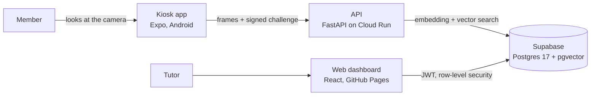

# AILAB-FACIAL — Facial-recognition attendance control

[](https://github.com/Diogo-Olivv/AILAB-FACIAL/actions/workflows/ci.yml)
[](https://github.com/Diogo-Olivv/AILAB-FACIAL/actions/workflows/codeql.yml)
[](LICENSE)
[](docs/README.md)

Replace the paper sign-in sheet of a university makerspace with a tablet at the door. The member looks at the camera, the server recognizes them, and check-in or check-out is recorded. Tutors follow the hours on a web dashboard.

> **Status: under remediation.** A public security and privacy audit (2026-11-11) found open issues, and every one is tracked with its evidence and owner in [audit/REMEDIATION_STATUS.md](audit/REMEDIATION_STATUS.md). Read it before operating the system.

[Versão em português](README.pt-BR.md) · [Documentation](docs/README.md) · [Security policy](SECURITY.md) · [Contributing](CONTRIBUTING.md) · [Roadmap](docs/ROADMAP.md)

## Why this project is worth a look

Most attendance demos stop at "it recognizes a face". This one is built and documented as a system that handles **biometric data about real people**:

- **Server-side only biometrics.** The tablet captures and sends. Templates and thresholds never leave the server ([ADR 0001](docs/adr/0001-server-side-recognition.md)).
- **Anti-spoofing and anti-replay in the design.** Presentation-attack detection (MiniFASNetV2), a screen-flash check across frames, a signed per-device capture challenge, and an idempotent replay guard in PostgreSQL ([ADR 0006](docs/adr/0006-replay-guard-in-postgres.md)). The replay guard is implemented and tested; its rollout to production is still pending (see the status above).
- **Security enforced by the database.** Row-level security by role, per-device kiosk accounts, and atomic RPCs for presence and for LGPD rights ([ADR 0003](docs/adr/0003-supabase-rls-service-role.md), [ADR 0005](docs/adr/0005-individual-kiosk-jwt.md)).
- **Tested against a real database.** More than 300 automated tests across backend, web and kiosk app. The backend suite runs against PostgreSQL 17 with pgvector in CI, and a skipped database test **fails** the build instead of passing silently.
- **Radical transparency.** The audit, the drift between code and production, and the open risks are public: [audit/](audit/README.md). The [model card](docs/ml/model-card.md) says "not measured" where there is no measurement, instead of inventing accuracy numbers.
- **Decisions on record.** Nine [architecture decision records](docs/adr/README.md), a [documentation set](docs/README.md) organized by [Diátaxis](https://diataxis.fr/), and runbooks for incidents, cold starts and stale sessions, plus a how-to for secret rotation.

## How it works



Details: [architecture](docs/explanation/architecture.md), [recognition sequence](docs/explanation/sequence-recognition.md), [enrollment sequence](docs/explanation/sequence-enrollment.md), [biometric pipeline](docs/explanation/biometric-pipeline.md).

## Quick start

```bash
cd backend && pip install -r requirements-dev.txt && python -m pytest -q
cd web && npm ci --legacy-peer-deps && npm run test
```

Full walkthrough: [docs/tutorials/first-run-local.md](docs/tutorials/first-run-local.md). Configuration: [docs/reference/env-vars.md](docs/reference/env-vars.md). API: [docs/reference/api.md](docs/reference/api.md).

## Documentation

[Tutorials](docs/tutorials/) · [How-to guides](docs/how-to/) · [Reference](docs/reference/) · [Explanations](docs/explanation/) · [ADRs](docs/adr/README.md) · [Privacy](docs/privacy/) · [ML model card](docs/ml/model-card.md) · [Runbooks](docs/runbooks/)

## Security and privacy

Report vulnerabilities privately, following [SECURITY.md](SECURITY.md). Never open a public issue with personal data, images, tokens or keys.

The project does **not** claim compliance with Brazil's LGPD. It documents its controls and its gaps: [audit/LGPD_GAP_ANALYSIS.md](audit/LGPD_GAP_ANALYSIS.md).

## Contributing

Contributions are welcome. See [CONTRIBUTING.md](CONTRIBUTING.md), [CODE_OF_CONDUCT.md](CODE_OF_CONDUCT.md), [GOVERNANCE.md](GOVERNANCE.md) and, for coding agents, [AGENTS.md](AGENTS.md). Good places to start: the open items in [audit/REMEDIATION_STATUS.md](audit/REMEDIATION_STATUS.md) and [docs/ROADMAP.md](docs/ROADMAP.md).

## Citing

If you use this software in research, cite it using [CITATION.cff](CITATION.cff).

## License

Apache License 2.0. See [LICENSE](LICENSE) and [NOTICE](NOTICE).
