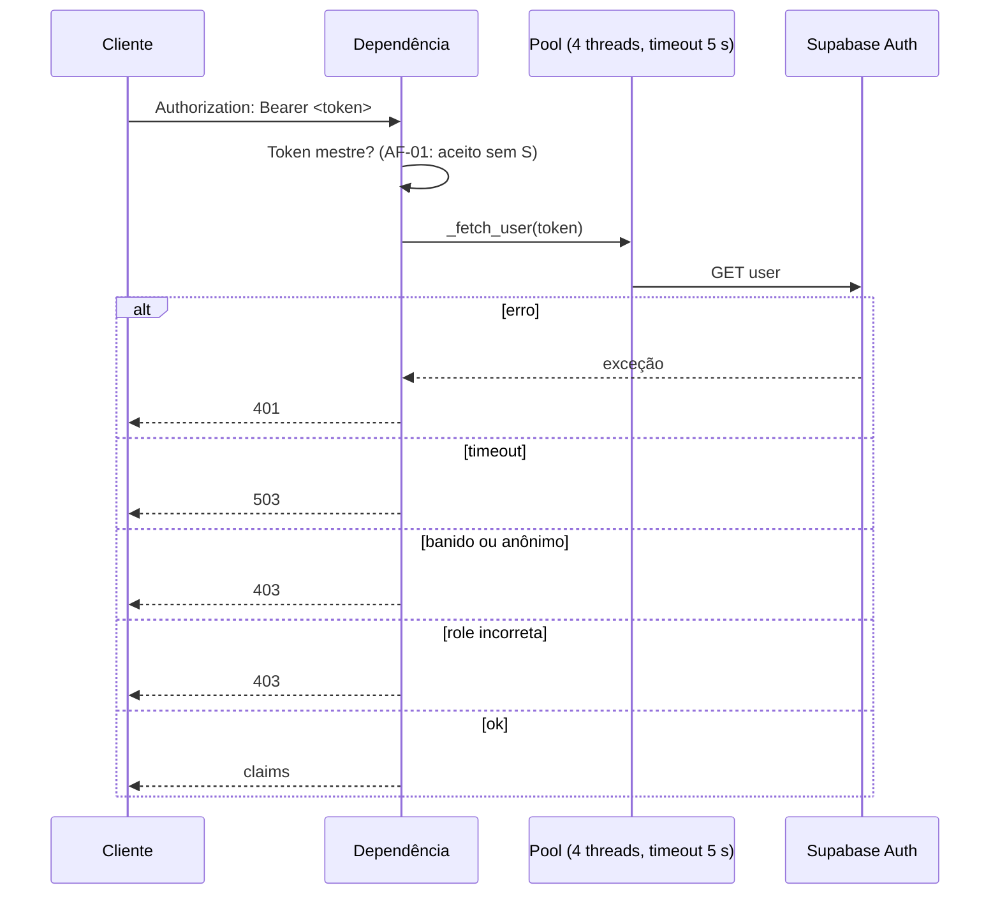
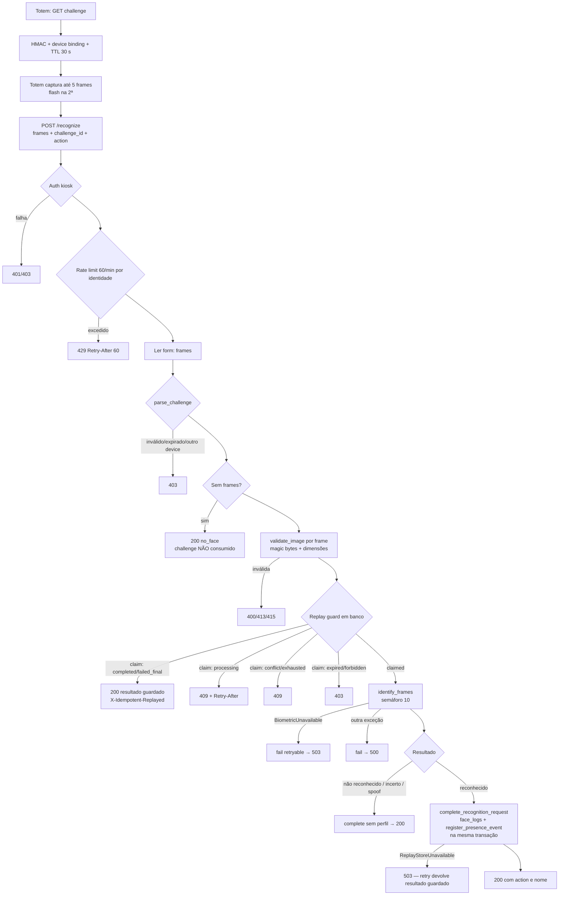
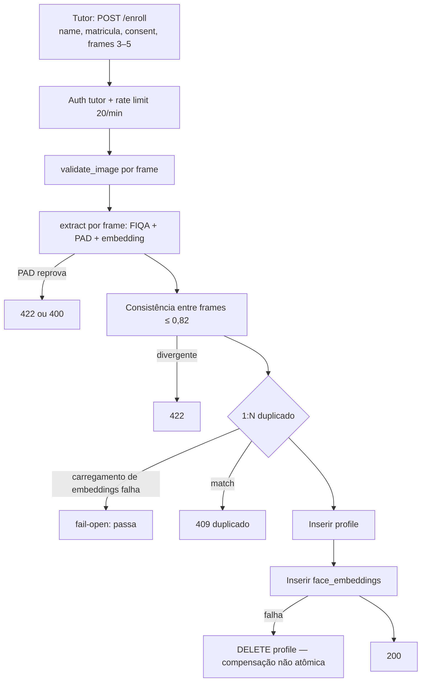

# Catálogo de fluxos e caminhos de falha

> Revisado em 2026-11-11 · base `master@5f1d99c` · fonte: leitura do código (`backend/app/routers`, `services`, `deps.py`, `migrations`) e do app (`mobile/`, `web/`).
> Legenda: **F** fato lido no código · **F\*** relatado por leitura de agente, não reconfirmado linha a linha · **I** inferência · **H** hipótese · **NV** não verificado.
> Achados `N-xx` são de `FINDINGS.md`; `AF-xx` de `REMEDIATION_STATUS.md`.

Todas as rotas da API estão sob `/api/v1`, exceto `/health` e `/health/ready`. Middleware, de fora para dentro: `UploadGuard` (`backend/app/upload_guard.py`), CORS, roteador.

## 1. Autenticação e identidade

Três papéis (F, `backend/app/deps.py`):

| Dependência | Aceita | Cache | Notas |
|---|---|---|---|
| `verify_kiosk_identity` | JWT de conta `kiosk` (ou token mestre, **AF-01**) | 60 s, só para kiosk | |
| `verify_tutor_token` | JWT com `app_metadata.role=tutor` (ou token mestre, **AF-01**) | não | |
| `verify_kiosk_or_tutor` | qualquer um dos dois | só kiosk | |
| `require_tutor_or_window` | tutor sempre; kiosk só dentro de `enrollment_window` | — | Janela fixa 2026-09-28 a 2026-10-02 (`enrollment_window.py`). Vencida hoje: código morto na prática (**N-03**). |
| `verify_admin_or_scheduler` | `X-Admin-Key` (comparação constante) ou OIDC do Cloud Scheduler | — | |

Sequência de resolução de identidade (F, `deps.py`):

**Achado (N-02, F\*):** o pool tem 4 workers e o cache negativo não existe. Quatro requisições não autenticadas lentas esgotam o pool e causam 503 para todos durante até 5 s. A verificação local de assinatura JWT (JWKS) eliminaria a chamada de rede por requisição.

## 2. Reconhecimento (check-in e check-out)

Fluxo do totem (F, `backend/app/routers/recognize.py`, `POST /recognize`):

Pontos de atenção (F):

- O desafio expirado ainda é aceito na etapa de parse (`parse_challenge`), e a rejeição por expiração só aparece depois, conforme o estado da linha. Confirmar com teste (NV).
- Nenhum registro em `face_logs` ou `sessions` para resultados não reconhecidos, spoof ou incertos (F). Tentativas de fraude não geram evento de segurança (**N-17**).
- O mesmo `identify_frames` é usado para 1 e para várias fotos. Com várias fotos, cada uma é identificada isoladamente e a de maior confiança vence, sem exigir concordância entre frames (**N-14**, F\*).
- Com o replay guard desligado (só dev), o desafio é consumido em memória e a escrita é feita com trava assíncrona por perfil (F).

### Confiança e limiares (F, `backend/app/config.py`)

| Parâmetro | Valor padrão | Uso |
|---|---|---|
| `face_min_cosine` | 0,62 | aceite |
| `face_uncertain_cosine` | 0,55 | zona incerta |
| `face_threshold` (distância) | 0,87 | limite de distância; equivale a cosseno ~0,6216 (**N-15**) |
| `min_laplacian_var` | 20,0 | nitidez |
| `enroll_max_pairwise_distance` | 0,82 | consistência da rajada |
| `pad_require_model` | `None` → `True` em produção | PAD obrigatório |

Os valores de `.env.example` (0,68 etc.) **não** são os padrões (**N-15**, F).

## 3. Cadastro (enroll)

- **Fail-open (N-13, F):** `_load_embeddings` captura qualquer exceção, registra `log.error` e devolve `None`. `_check_1_to_n_duplicate` trata `None` como "ninguém cadastrado" e retorna sem bloquear. Uma falha transitória do banco permite cadastrar a mesma pessoa de novo.
- **Sem trava** entre a checagem e a inserção (F\*): duas inscrições simultâneas da mesma pessoa podem passar.
- **Retorno de erro (F\*):** erros de banco podem chegar ao cliente com a mensagem bruta do Postgres (**N-13**).
- **Mensagem de consentimento** é validada no backend (`enroll_service.py`), mas a tela de consentimento é um `Switch` operado pelo tutor no tablet (UX).

## 4. Atualização de template (refresh-embedding)

- Mesma extração do cadastro. Depois `_guard_against_identity_swap` (checa que o rosto novo não casa com outro membro) e a RPC atômica `replace_profile_embeddings` (migração 26), que recusa perfil inativo ou revogado.
- **Lacuna (N-03, F\*):** a verificação não compara o rosto novo com o template anterior do mesmo perfil. Dentro da janela, qualquer token de kiosk pode trocar o template de qualquer perfil. Hoje a janela está vencida, mas a rota continua registrada.

## 5. Ativação de totem (kiosk)

1. Tutor autentica no app (`TutorPinModal`) e informa um rótulo (`KioskProvisionModal`).
2. `POST /kiosks` (rate limit 10/min) cria o usuário em Supabase Auth com e-mail `kiosk-<hex>@kiosk.ailab.invalid` e senha aleatória, devolve a credencial **uma vez**, e grava auditoria (`admin_audit_log`).
3. O totem faz login com essa credencial (`activateKiosk`, `mobile/lib/kioskIdentity.ts`) e passa a usar o JWT de kiosk.

**Achados:**
- Auditoria com ator token mestre quebra (**N-04**, F\*): `tutor.get("user_id")` vira a string `tutor-master-id`, que é passada como `p_actor` de RPC que espera `uuid`. Confirmado no código que o valor é esse (`deps.py:146`); o erro de tipo é inferido.
- Listagem de kiosks lê só as primeiras 2000 contas (**N-22**, F\*).
- Revogação apaga a conta, mas o cache local de 60 s mantém o acesso no processo (**N-22**).
- Hoje há 0 contas de kiosk em produção (F, snapshot). O totem usa a chave compartilhada (**AF-04**).

## 6. Operações do tutor sobre sessões

| Rota | Efeito | Lock | Achados |
|---|---|---|---|
| `POST /sessions/manual` | insere sessão com horários informados | nenhum | Sem validação de `check_in < check_out`, sem limite de futuro, sem checagem de sobreposição (**N-06**, F\*) |
| `POST /sessions/entry` | insere entrada | nenhum; a RPC `tutor_register_entry` existe e não é usada | Entrada duplicada dá erro de unicidade → 500 (**N-06**, F\*) |
| `POST /sessions/tutor-close` | fecha (checkout) ou anula (void) | RPC com lock; em erro, **cai para UPDATE direto** sem lock | Erros de RPC engolidos (**N-06**, F\*) |
| `POST /sessions/close-stale` | anula sessões antigas | Python, sem `check_out IS NULL` no UPDATE | Pode anular um checkout que aconteceu depois da leitura (**N-18**, F\*) |
| `GET /sessions/open` | lista presentes | — | Não filtra perfil inativo nem revogado (**N-08**, F\*) |
| `GET /sessions/stats/{id}` | horas totais | — | Mês 13 causa 500; `month` sem `year` é ignorado; sem paginação (teto PostgREST); qualquer kiosk lê horas de qualquer perfil (**N-07**, F\*) |

Regra de sessão (F, migração 24): um perfil tem no máximo uma sessão aberta (índice único parcial). `register_presence_event` usa trava consultiva por perfil, debounce de 60 s e considera vencida uma sessão aberta há 10 h ou mais, ou aberta antes do dia atual em horário de Brasília. **Consequência (N-19, F\*):** sessão que atravessa meia-noite ou passa de 10 h é anulada, e a marcação de saída legítima vira entrada nova.

## 7. Revogação de consentimento e exclusão (LGPD)

- `POST /profiles/{id}/revoke-consent` → RPC `revoke_profile_consent`: marca `active=false`, `consent_given=false`, grava `consent_revoked_at`, apaga embeddings e grava auditoria. **Não** fecha sessão aberta, **não** limpa nome, matrícula ou avatar (**N-08, N-21**, F\*). Qualquer erro de RPC vira 503.
- `DELETE /profiles/{id}` → RPC `delete_profile_cascade`. Se houver justificativa, devolve 409 (`ON DELETE RESTRICT`, migração 27). Justificativas podem conter texto livre sensível (**N-21**, F\*).
- **Consequência:** perfil com justificativa não pode ser apagado, e o texto de justificativa fica sem prazo (**N-21**, F\*). Decisão de retenção pendente (DP-6).
- O painel web chama `tutorRemoveMember` com fallback de escrita direta (**AF-28**, F).

## 8. Justificativas de débito (web)

`web/src/lib/compliance.ts`: `justify_attendance_debt` e `revoke_attendance_justification` (RPCs, JWT de tutor). Em erro com código `42501`, `PGRST202` ou `42883`, o cliente trata como "RPC ausente" e **grava a justificativa só em `localStorage`** com sucesso visível (**AF-28**, F; commit `cbe481d`). Isso mascara permissão negada e cria divergência entre o que o tutor vê e o que está no banco.

## 9. Manutenção e sweeps

| Job | Mecanismo | Achados |
|---|---|---|
| Limpeza de `face_logs` > 90 dias | `POST /maintenance/cleanup` com `X-Admin-Key`, chamado por `nightly-cleanup.yml` (cron 0 * * * * e 59 2 * * *) | `purge_old_face_logs` engole erros e devolve 0: a limpeza pode falhar em silêncio (**N-18**, F\*) |
| Purga de `recognition_requests` (300 s) | pg_cron, se a extensão existir (migração 25) | `replay_guard.purge()` nunca é chamado pelo código (**N-18**, F\*); pg_cron não verificado (NV) |
| Anulação de sessões antigas | três implementações divergentes (Python, SQL, `register_presence_event`) | **N-18, N-19** |

Agendamento: GitHub Actions (`nightly-cleanup.yml`), que é best-effort e pausa após 60 dias sem atividade do repositório (F\*).

## 10. Janela de cadastro e identidade de tablet

- `enrollmentWindow.ts` (mobile) e `enrollment_window.py` (backend) têm as mesmas constantes (F): 2026-09-28 a 2026-10-02, UTC-3, inclusivo. Hoje está vencida (F, data 2026-11-11).
- O mobile usa o relógio do dispositivo; o backend é a referência. Diferença pode causar divergência nas bordas (F\*).
- Código dependente da janela (`require_tutor_or_window`, `refresh-embedding` por kiosk) fica inerte fora dela, mas continua no código (**N-03**).

## 11. Web: sessão e navegação

- `App.tsx`: `/login`, `/dashboard` e `*` → `/dashboard` (F). `/dashboard` **não tem guarda de rota**; a visão de tutor aparece quando há usuário e não é `?mode=student` (`Dashboard.tsx:580`, F). `RequireTutorAuth` não é importado em lugar nenhum (F). A autoridade real está no backend e na RLS, não na interface.
- `AuthProvider` aceita senhas mestras e forja sessão local com role `tutor` (**AF-03**, F).
- Escrita direta quando a RPC falha: `web/src/lib/reports.ts` (**AF-28**, F).
- Avisos disciplinares só em `localStorage` (**AF-29**, F).

## 12. Mobile: totem

1. `kioskStatus` = `loading` / `provisioned` / `unprovisioned` (`kioskIdentity.ts`). `isKioskSession` também devolve verdadeiro se `EXPO_PUBLIC_KIOSK_KEY` existir (F), ou seja, o próprio fallback vira "provisionado".
2. Auto-Scan dispara `capture` a cada 2 s sem detectar rosto (**AF-27**, F, `RecognitionPanel.tsx:318-331`).
3. Falha de rede mostra "Registro não confirmado" sem fila de reenvio (F\*).
4. Tela sem `useKeepAwake` (F\*): o tablet pode dormir.

## 13. Caminhos de falha sem tratamento explícito (resumo)

| Caminho | Comportamento atual | Esperado | Ref. |
|---|---|---|---|
| Banco indisponível na checagem de duplicidade | passa (fail-open) | bloqueia | N-13 |
| RPC de presença ausente | 503 ou erro (**H** conforme env) | erro explícito e alerta | CODE_DB_DRIFT D-01 |
| Replay store indisponível | 503 | 503 com retry e sem efeito | ok (F) |
| Permissão negada no cliente web | tratada como "RPC ausente" | erro visível | AF-28 |
| Purga de logs falha | retorna 0, job "ok" | erro | N-18 |
| Token mestre em rota de auditoria | erro de tipo mascarado | 401 ou ator texto | N-04 |
| Sessão atravessa meia-noite | anulada | fechar no limite ou revisar | N-19 |

## 14. Cobertura de testes por fluxo

| Fluxo | Cobertura automatizada (F) |
|---|---|
| Autenticação e dependências | `test_security_lgpd.py`, `test_master_token_rejection.py` (xfail, AF-01) |
| Desafio e replay em memória | `test_capture_challenge.py` (12 casos) |
| Replay em banco e presença em produção-config | **Não coberto** (testes forçam `persistent_replay_guard=False` e `presence_via_rpc=False`); cobertura parcial em `test_db_migrations.py` (RPCs de claim e presença, 41 casos de banco no CI) |
| Cadastro, duplicidade e swap | `test_biometrics.py` (mocks de `_load_embeddings`). **Fail-open (N-13) não testado** |
| LGPD (revogar, excluir) | `test_db_migrations.py` (testes de banco); rotas com mocks |
| Upload | `test_kiosk_and_upload_hardening.py`, `test_security_lgpd.py` (cabeçalho e tamanho; corpo chunked sem teste) |
| Web: lógica de horas e CSV | `web/src/lib/*.test.ts` (61 casos com `sw_offline`) |
| Mobile | **Nenhum** (AF-19) |
| Service worker | `web/src/lib/sw_offline.test.ts` (3 casos, em Node) |

## 15. Pendências de verificação deste catálogo

- Confirmar em teste o comportamento de desafio expirado (seção 2).
- Confirmar N-04 (erro de tipo do `p_actor`) executando a RPC com um valor não UUID em banco de teste.
- Confirmar N-13 com teste que simula falha de leitura de `face_embeddings`.
- Confirmar N-16 (nomes em log): os trechos lidos registram `type(exc).__name__`; a exposição de nomes não foi reconfirmada.
