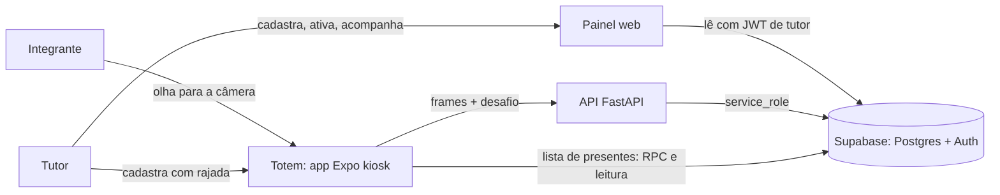

# Arquitetura

> Substitui o `ARQUITETURA.md` da raiz. Descreve o sistema em `master@5f1d99c`, com data de revisão 2026-11-11.

## Contexto (C4 nível 1)

O sistema registra a presença de integrantes de um laboratório de extensão. Três atores interagem com ele:

- **Integrante:** se aproxima do totem e é reconhecido.
- **Tutor:** cadastra integrantes, ativa totens e acompanha horas pelo painel.
- **Mantenedor:** implanta, opera e responde a incidentes.

## Contêineres (C4 nível 2)

| Contêiner | Tecnologia | Responsabilidade | Onde roda |
|---|---|---|---|
| Totem | Expo (React Native), APK Android | Captura, desafio, envio de frames, exibição | Tablet na entrada |
| API | FastAPI, InsightFace, ONNX | Reconhecimento, cadastro, sessões, LGPD | Cloud Run, `southamerica-east1` |
| Banco e Auth | Supabase (Postgres 17, pgvector, GoTrue) | Dados, RLS, RPCs, contas | Supabase, `sa-east-1` |
| Painel | React 19, Vite, PWA | Acompanhamento e gestão pelo tutor | GitHub Pages |
| Automação | GitHub Actions | CI, deploy, limpeza noturna | GitHub |

## Fluxo principal

Para o detalhe com caminhos de falha, ver `audit/FLOWS.md`.

Resumo: o totem pede um desafio, captura de 1 a 5 frames, envia tudo à API. A API valida a identidade do totem, confere o desafio, calcula o embedding, compara com os templates no banco e grava a presença em uma única transação.

## Decisões que moldam o sistema

- Reconhecimento no servidor, não no tablet: [adr/0001](../adr/0001-server-side-recognition.md).
- Busca vetorial com pgvector e HNSW: [adr/0002](../adr/0002-pgvector-hnsw.md).
- Segurança de acesso no banco, com RLS e `service_role` só no backend: [adr/0003](../adr/0003-supabase-rls-service-role.md).
- Cloud Run em vez de Render: [adr/0004](../adr/0004-cloud-run-over-render.md).
- Conta de kiosk por dispositivo: [adr/0005](../adr/0005-individual-kiosk-jwt.md) (aceito, ainda não implantado).
- Anti-replay no Postgres: [adr/0006](../adr/0006-replay-guard-in-postgres.md).

## Onde a arquitetura diverge do que está em produção

- Código e banco não batem: funções de presença e de replay não existem em produção (ver `audit/CODE_DB_DRIFT.md`).
- Credenciais compartilhadas ainda existem (**AF-01**, **AF-04**).
- O deploy não depende do CI (**CI-01**).

Este diagrama descreve o desenho alvo e o código. Para o estado real, leia `audit/PROD_STATE_SNAPSHOT.md`.
