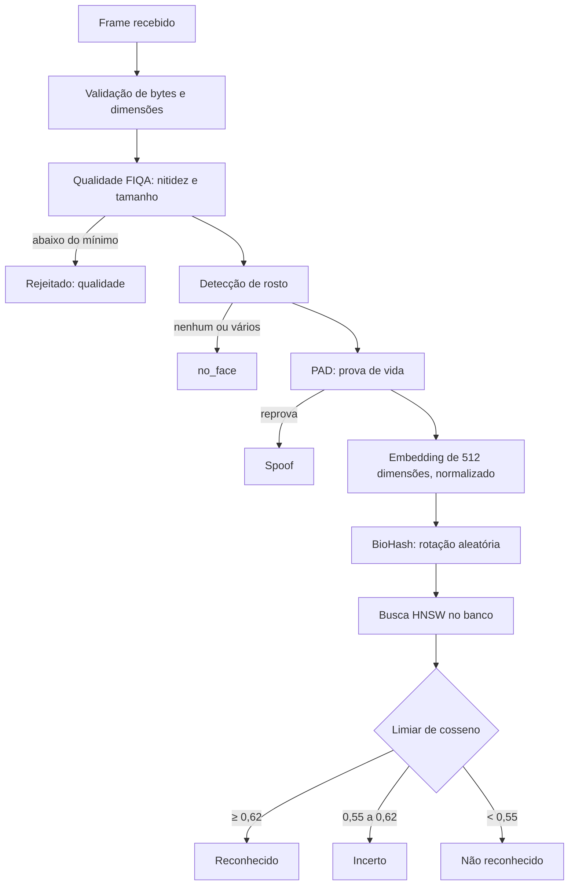

# Pipeline biométrico

Explica o caminho de uma foto até o registro de presença, e o que cada etapa protege. Números e limiares vêm do código (`backend/app/config.py`); a medição de qualidade está em [ml/model-card.md](../ml/model-card.md).

## Etapas

## O que cada etapa protege

| Etapa | Protege contra | Limite conhecido |
|---|---|---|
| Qualidade | Foto ruim gera embedding ruim, que causa falsa rejeição | Limiar de nitidez de 20 foi adaptado para câmera de tablet; não validado com dados |
| Detecção | Imagens sem rosto ou com vários rostos | Escolhe o maior rosto; pode escolher a pessoa errada em cena cheia |
| PAD | Foto impressa, tela | Medido só com imagens sintéticas (ver `ml/model-card.md`) |
| BioHash | Reconstrução do rosto a partir do template | Semente padrão pública (**N-12**); sem ela, a proteção é cosmética |
| Limiar de cosseno | Falsa aceitação | Equilíbrio com falsa rejeição não medido com dados reais |
| Zona incerta | Decisão precipitada | Ainda não há segunda etapa: o sistema trata incerto como não reconhecido na prática (**N-15**) |

## Cadastro e atualização

- Cadastro usa de 3 a 5 fotos. As fotos são comparadas entre si (distância máxima de 0,82). Se divergirem, o cadastro é recusado.
- Antes de gravar, o sistema procura duplicidade contra os templates ativos. **Hoje essa checagem falha aberta quando a leitura do banco falha** (**N-13**).
- A atualização troca o template, mas não compara o rosto novo com o antigo do mesmo integrante (**N-03**, dentro da janela).

## Reconhecimento

- Com várias fotos, cada uma é avaliada separadamente e a de maior confiança vence. Não é exigido que todas concordem (**N-14**).
- O desafio de captura é validado antes de qualquer cálculo.
- Resultado negativo não grava nada em `face_logs` nem em `sessions`. Tentativas de fraude também não geram alerta (**N-17**).

## Por que o modelo roda no servidor

Ver [adr/0001](../adr/0001-server-side-recognition.md). Em resumo: o tablet é o ponto mais fácil de comprometer, e o servidor controla os limiares, o registro e a auditoria.

## Pontos que precisam de medição

Nenhum limiar deste pipeline foi medido com um conjunto de dados rotulado e representativo do laboratório. Os valores são de calibração de código, não de validação. Ver `docs/ml/model-card.md`.
