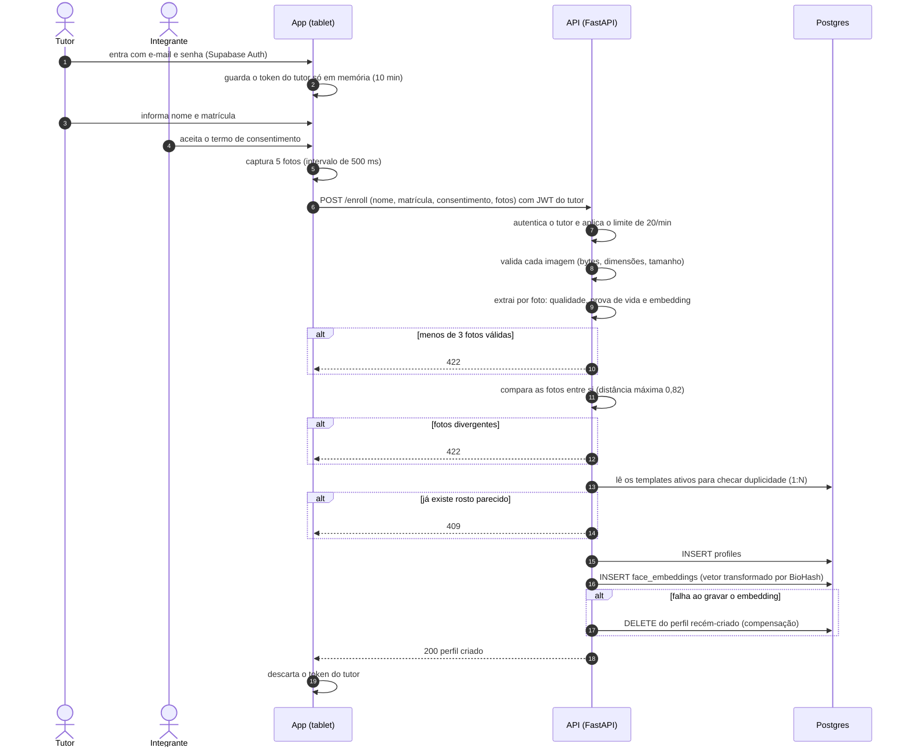

# Sequência: cadastro de integrante

Mostra o caminho de um cadastro novo, feito por um tutor no tablet. Baseado em `backend/app/routers/enroll.py` e `backend/app/services/enroll_service.py`. Falhas e lacunas em `audit/FLOWS.md`, seção 3.

## Pontos que valem atenção

- **Consentimento:** é validado no backend como campo obrigatório, mas o aceite hoje é um interruptor operado pelo tutor, e a versão do termo não é gravada (`audit/LGPD_GAP_ANALYSIS.md`).
- **Falha aberta na checagem de duplicidade (N-13):** se a leitura dos templates falhar, o código segue como se ninguém estivesse cadastrado. Uma falha transitória do banco pode permitir cadastrar a mesma pessoa duas vezes.
- **Sem trava entre a checagem e a inserção:** dois cadastros simultâneos da mesma pessoa podem passar.
- **Compensação não atômica:** se o segundo `INSERT` falhar, o perfil é apagado por um comando separado.
- **Fotos:** não são gravadas. O texto "descartadas imediatamente" depende da coleta de lixo do dispositivo e do servidor (**N-27**).
