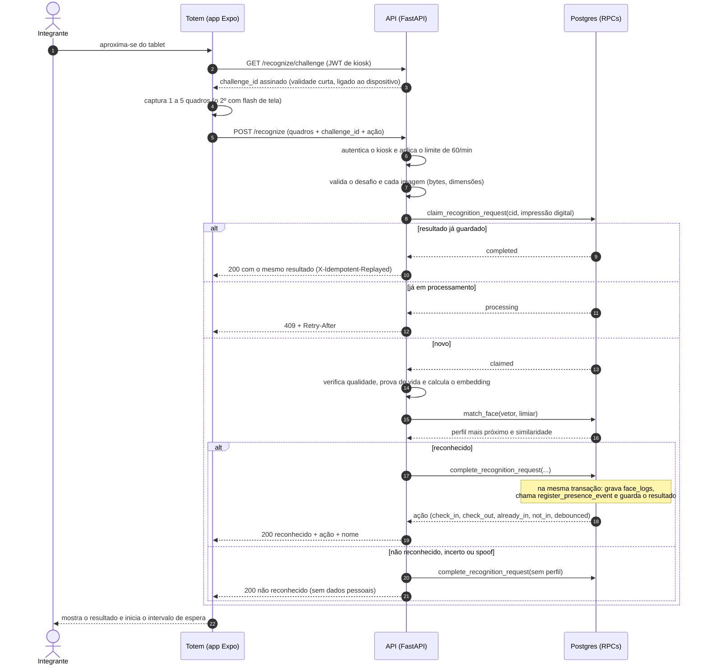

# Sequência: reconhecimento (check-in e check-out)

Mostra, em ordem, o que acontece entre o integrante olhar para o totem e a presença ser registrada. Baseado em `backend/app/routers/recognize.py` e nas migrations 24 e 25. Caminhos de falha completos em `audit/FLOWS.md`, seção 2.

> **Estado em produção (2026-11-11):** o desenho abaixo é o do código atual. As funções `register_presence_event` e `claim_recognition_request` ainda **não existem** no banco de produção (`audit/CODE_DB_DRIFT.md`, D-01 e D-02). Este diagrama descreve o comportamento alvo.

## Pontos que valem atenção

- **Idempotência:** repetir o mesmo desafio com as mesmas imagens devolve o mesmo resultado, sem registrar duas vezes. Se o conteúdo mudar, é conflito (409).
- **Atomicidade:** o registro de log, a mudança de presença e a guarda de replay acontecem na mesma transação do banco.
- **Debounce:** um novo registro do mesmo integrante em menos de 60 segundos devolve `debounced` e não altera a sessão.
- **Sessão que atravessa a meia-noite ou passa de 10 horas** é anulada e a nova marcação vira uma entrada (**N-19**).
- **Resultado negativo não grava nada** em `face_logs` nem em `sessions`. Tentativas de fraude não geram evento de segurança (**N-17**).
